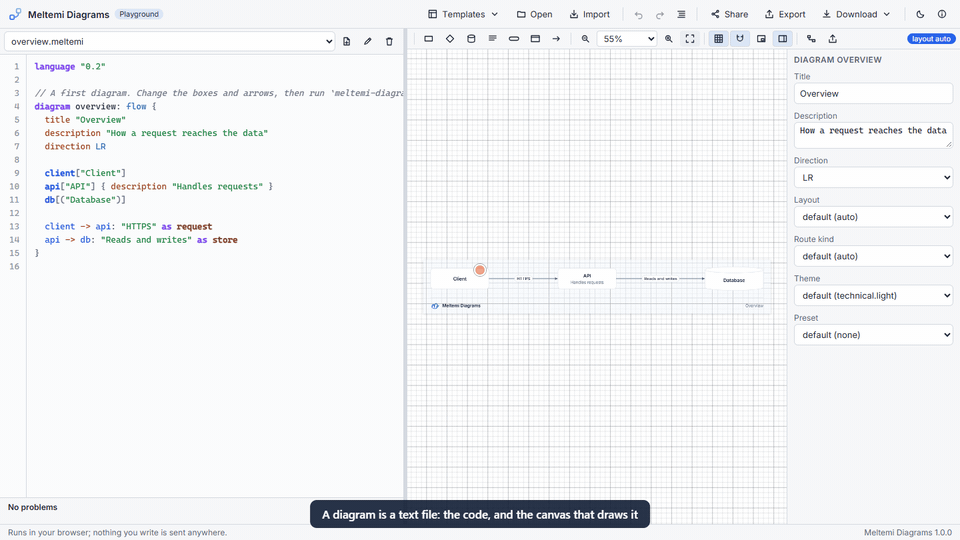
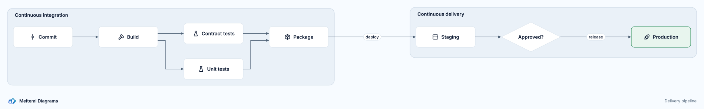
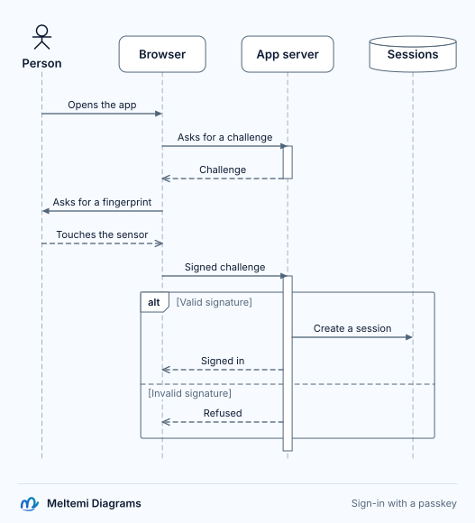
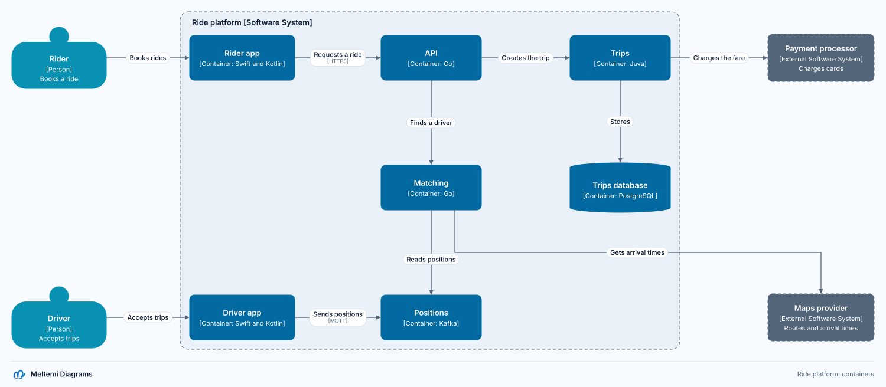
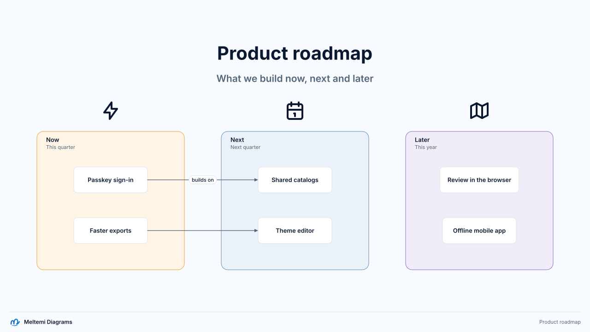

# Meltemi Diagrams

[Español](README.es.md)

Professional diagrams written as code, adjusted on a canvas, animated and exported, part of the
Meltemi family. You write `.meltemi` text files; the editor draws them beside the code, and every
drag, resize or label change on the canvas becomes a small edit of the same text. Code, layout and
motion live in files you review and version like the rest of your work.



- **Four profiles**: flow diagrams, sequence diagrams with scenarios, C4 views of a shared model,
  and free compositions for slides.
- **Code and canvas**: language services and a canvas with a grid, guides, routing and an
  inspector, in VS Code and in a browser [playground](docs/playground.md).
- **Motion**: effects along connectors and stories with scenes, camera and transitions.
- **Delivery**: SVG, PNG, vector PDF, an offline HTML player, MP4, WebM, GIF and a browsable
  catalog of a whole project.
- **Coming from elsewhere**: Mermaid and PlantUML importers that report every construct.
- **Local and open**: MIT licensed, no account, nothing leaves your machine; AI assistance is
  optional.

## Install

```bash
npm install --global @meltemi/diagrams-cli
```

The command is `meltemi-diagrams`, or `mdg`. It needs Node 22.12 or later; PNG, PDF and video use
an installed Edge or Chrome, and video an installed FFmpeg. The editor is the **Meltemi Diagrams**
extension for VS Code, and the playground, at
[diagrams.meltemi.dev](https://diagrams.meltemi.dev), needs no installation at all
([playground](docs/playground.md), [getting started](docs/getting-started.md)).

## A first diagram

```bash
meltemi-diagrams init shop
```

```text
language "0.2"

diagram overview: flow {
  title "Overview"
  direction LR

  client["Client"]
  api["API"] { description "Handles requests" }
  db[("Database")]

  client -> api: "HTTPS" as request
  api -> db: "Reads and writes" as store
}
```

```bash
meltemi-diagrams export shop --format png
```

Open the file in VS Code to drag the boxes on the canvas, or run
`meltemi-diagrams preview shop --open` to see every change as you save.

## Trying it from this repository

Everything can be tried from a checkout, before or without anything published. You need Node 22.12
or later and pnpm 10; PNG, PDF and video use an installed Edge or Chrome, and video an installed
FFmpeg.

### Set up once

```bash
pnpm install
```

```bash
pnpm build
```

### The command line

`pnpm mdg` runs the command from the sources; paths are relative to the repository's root.

```bash
pnpm mdg init try-it --template purchase
```

```bash
pnpm mdg validate try-it
```

```bash
pnpm mdg preview try-it --open
```

`preview` serves the project's catalog on `http://127.0.0.1:4317/` and redraws it every time a
`.meltemi` file is saved: edit a file under `try-it/diagrams/` in any editor and watch it change.
Then export it:

```bash
pnpm mdg export try-it --format png
```

```bash
pnpm mdg export try-it/stories/purchase.meltemi --story purchase --format mp4
```

```bash
pnpm mdg build catalog try-it
```

To use the command from any folder, as if it were installed, point a shell function at the built
command (after `pnpm build`), replacing the path with your checkout's. In PowerShell:

```powershell
function mdg { node C:\path\to\meltemi-diagrams\packages\cli\dist\bin.js @args }
```

In Bash:

```bash
mdg() { node /path/to/meltemi-diagrams/packages/cli/dist/bin.js "$@"; }
```

### The editor in VS Code

Package the extension and install it:

```bash
pnpm vscode:package
```

```bash
code --install-extension packages/vscode/meltemi-diagrams.vsix
```

Open the `try-it` folder in VS Code and any `.meltemi` file in it: the canvas opens beside the
code. Drag a box, double-click a label, or connect two boxes from the dots beside a selected one,
and watch the text change. Without installing anything, open this repository in VS Code and press
F5 with **Run Meltemi Diagrams**: an Extension Development Host opens on `examples/`
([editor](docs/editor.md)).

### The playground

```bash
pnpm playground:build
```

```bash
pnpm preview
```

Then open `http://localhost:4173/packages/playground/dist/`. `pnpm preview` serves the whole
repository on port 4173, so exported files can be opened from it too ([playground](docs/playground.md)).

### What is already generated

No command is needed to look at these:

- [gallery/README.md](gallery/README.md): the four profiles with their SVG, PNG and PDF exports;
- [examples/purchase/exports/catalog/index.html](examples/purchase/exports/catalog/index.html): the
  purchase example's catalog, which opens from disk and works offline;
- [examples/purchase/exports/purchase-story.html](examples/purchase/exports/purchase-story.html):
  the story in the HTML player;
- [docs/media/editing-demo.mp4](docs/media/editing-demo.mp4): the editing demo.

### Checking everything

```bash
pnpm test
```

```bash
pnpm acceptance
```

```bash
pnpm release:check
```

`pnpm test` runs every package's tests. `pnpm acceptance` runs every acceptance criterion in about
twelve minutes and records the results in [docs/quality/results.md](docs/quality/results.md).
`pnpm release:check` builds and packs every package, installs the command from the packed files
into an empty folder, never from the registry, and runs it there: the closest thing to a published release
([releasing](RELEASING.md)).

## Gallery

| Flow                                                                                                                      | Sequence                                                                                                             |
| ------------------------------------------------------------------------------------------------------------------------- | -------------------------------------------------------------------------------------------------------------------- |
| [](gallery/README.md#flow-a-delivery-pipeline)                  | [](gallery/README.md#sequence-sign-in-with-a-passkey) |
| **C4**                                                                                                                    | **Free**                                                                                                             |
| [](gallery/README.md#c4-the-containers-of-a-ride-sharing-platform) | [](gallery/README.md#free-a-roadmap-slide)                               |

Each picture links to its source and its SVG, PNG and PDF exports. The
[purchase example](examples/purchase/README.md) draws one purchase in every profile, with a story,
a video and a catalog.

## Documentation

- [Getting started](docs/getting-started.md), [features](docs/features.md) and
  [compatibility](docs/compatibility.md)
- Coming from [Mermaid](docs/tracks/from-mermaid.md), [PlantUML](docs/tracks/from-plantuml.md) or a
  [visual editor](docs/tracks/from-visual-editors.md)
- The [language reference](docs/language/grammar-0.2.md), the [command line](docs/cli.md) and the
  [editor](docs/editor.md)
- [Everything else](docs/README.md)

## Status

Version 1.10.0: the complete product described in `propuesta-detallada-diagramas-como-codigo.pdf`
(Spanish), built through the changes of the [1.0 roadmap](docs/roadmap-1.0.md), with styling and
custom themes on the canvas since 1.1.0, arrow ends, connector shapes and the trace effect since
1.2.0, English and Spanish everywhere since 1.3.0, connector ends pinned to points of sides since
1.4.0, connectors meeting boxes at any point of their border since 1.5.0, connectors that go
around boxes with canvas colours from the theme since 1.6.0, element libraries with the cloud
providers' icons and layers in flow diagrams since 1.7.0, plain containers, stacks, corner
radii, twenty-four shapes and icons placed anywhere in a box or drawn as the shape since 1.8.0,
HTML drawings that zoom, show cards and panels, and open what a box holds since 1.9.0, the first
published, and the playground's project explorer, lines and a hand-drawn look, the pointer and
notes, and one prompt that sets up a coding agent since 1.10.0, as the [changelog](CHANGELOG.md)
records. Every acceptance criterion passes on the reference
machine ([results](docs/quality/results.md)). Work is planned with OpenSpec under `openspec/`.

## Performance

On the reference machine (decision 0032), the analysis a file gets after an edit and a canvas drag
from the message to the new drawing stay well inside their targets for views of 30 elements in
every profile:

| Target (p95)                        |  Limit | Measured, worst profile |
| ----------------------------------- | -----: | ----------------------: |
| analysis after an edit              | 500 ms |                   56 ms |
| canvas drag, message to new drawing | 100 ms |                   19 ms |
| first export from a template (CLI)  |   60 s |                    35 s |

`pnpm bench` prints parse, compile, export and arrangement timings, and `pnpm bench --write`
records them in [docs/performance.md](docs/performance.md). How every acceptance criterion is
checked, and the latest results, are in [docs/quality.md](docs/quality.md) and
[docs/quality/results.md](docs/quality/results.md).

## Repository layout

| Path                  | Contents                                                                                                                    |
| --------------------- | --------------------------------------------------------------------------------------------------------------------------- |
| `packages/language`   | `@meltemi/diagrams-language`: lexer, parser, CST, diagnostics, text edits                                                   |
| `packages/model`      | `@meltemi/diagrams-model`: intermediate model, `flow`, `free` and `sequence` validation, scenarios, JSON                    |
| `packages/edit`       | `@meltemi/diagrams-edit`: structured operations to minimal text edits                                                       |
| `packages/layout`     | `@meltemi/diagrams-layout`: layout of flow, free and sequence diagrams into a vector scene, constraints, routing and checks |
| `packages/layout-elk` | `@meltemi/diagrams-layout-elk`: the ELK layout engine (elkjs, EPL-2.0)                                                      |
| `packages/render`     | `@meltemi/diagrams-render`: vector scene to portable SVG                                                                    |
| `packages/project`    | `@meltemi/diagrams-project`: projects, manifests, imports, incremental workspace                                            |
| `packages/fonts`      | `@meltemi/diagrams-fonts`: bundled OFL fonts, text measurement, embedding, outlines                                         |
| `packages/assets`     | `@meltemi/diagrams-assets`: icon packs, SVG sanitising, licences, the asset lock                                            |
| `packages/motion`     | `@meltemi/diagrams-motion`: effects on a deterministic clock, frames at any time and the animated SVG profile               |
| `packages/i18n`       | `@meltemi/diagrams-i18n`: the two languages, typed catalogs and formatting by language                                      |
| `packages/import`     | `@meltemi/diagrams-import`: Mermaid and PlantUML importers, the preprocessor, coverage tables, re-import                    |
| `packages/player`     | `@meltemi/diagrams-player`: the HTML player of stories and effects, and its documents                                       |
| `packages/capture`    | `@meltemi/diagrams-capture`: PNG, PDF and video captures through the installed browser and FFmpeg                           |
| `packages/catalog`    | `@meltemi/diagrams-catalog`: the offline HTML catalog of a project                                                          |
| `packages/assist`     | `@meltemi/diagrams-assist`: optional AI assistance, its adapters and reviewable proposals                                   |
| `packages/cli`        | `@meltemi/diagrams-cli`: the `meltemi-diagrams` command                                                                     |
| `packages/editor`     | `@meltemi/diagrams-editor`: language services, project sessions, exports, the canvas session, host-neutral                  |
| `packages/canvas`     | `@meltemi/diagrams-canvas`: the canvas application, shared by the extension and the playground                              |
| `packages/vscode`     | the Meltemi Diagrams extension for VS Code: language support and the canvas                                                 |
| `packages/playground` | the playground: a static web page with templates, code, the canvas and every export                                         |
| `packages/cloud`      | the cloud service: a Worker with the optional account, API tokens and projects in the cloud ([cloud](docs/cloud.md))        |
| `packages/acceptance` | the acceptance suite: corpus conditions, visual regression, determinism, benchmark and the export verification runners      |
| `gallery/`            | one sheet of each profile with its SVG, PNG and PDF exports                                                                 |
| `corpus/`             | reference `.meltemi` files and projects, snapshots and edit fixtures; `corpus/acceptance/` for the acceptance criteria      |
| `schemas/`            | JSON schemas, such as `project.schema.json` for `project.json`                                                              |
| `examples/`           | the purchase reference example with every export, and real sheets converted to `.meltemi`                                   |
| `skills/`             | the `meltemi-diagrams` Agent Skill for Claude Code, Codex and other agents                                                  |
| `scripts/`            | development helpers such as the preview server                                                                              |
| `docs/language/`      | grammar, diagnostics, styles, assets, fonts, projects and model JSON references                                             |
| `docs/import/`        | what the Mermaid and PlantUML importers map, approximate and drop, generated from the coverage tables                       |
| `docs/roadmap-1.0.md` | the ordered changes that build the complete 1.0                                                                             |
| `docs/decisions/`     | decision notes with criteria, alternatives and consequences                                                                 |
| `docs/quality.md`     | the acceptance criteria and how each is checked; results in `docs/quality/`, export checks in `docs/verification/`          |
| `openspec/`           | proposals, specs, designs and tasks                                                                                         |

## Scripts

| Script                         | Purpose                                                     |
| ------------------------------ | ----------------------------------------------------------- |
| `pnpm test`                    | run every package test with vitest                          |
| `pnpm typecheck`               | type-check every package                                    |
| `pnpm lint`                    | eslint and prettier checks                                  |
| `pnpm build`                   | compile every package to `dist/`                            |
| `pnpm mdg`                     | run the CLI from sources                                    |
| `pnpm bench`                   | timings and the editor's targets; `--write` records them    |
| `pnpm import:docs`             | regenerate `docs/import/` from the coverage tables          |
| `pnpm preview`                 | serve the repository on port 4173 to view exports           |
| `pnpm vscode:package`          | build the VS Code extension and check the `.vsix`           |
| `pnpm vscode:test-webview`     | test the canvas in a headless Edge or Chrome                |
| `pnpm vscode:test`             | test the extension inside VS Code                           |
| `pnpm playground:build`        | build the playground's static site                          |
| `pnpm playground:test-browser` | test the playground in a headless Edge or Chrome            |
| `pnpm cloud:dev`               | build the page and run the cloud service on port 8788       |
| `pnpm cloud:migrate`           | apply the cloud service's database migrations               |
| `pnpm cloud:test`              | test the cloud service in Node                              |
| `pnpm cloud:test-browser`      | test the cloud service in a headless Edge or Chrome         |
| `pnpm cloud:dev-session`       | prepare .dev.vars and sign-in cookies for local development |
| `pnpm acceptance`              | run every acceptance criterion and record the results       |
| `pnpm acceptance:visual`       | compare drawings with their pixel references                |
| `pnpm acceptance:determinism`  | export every format twice and compare the contents          |
| `pnpm acceptance:first-export` | time a template's way to exported files                     |
| `pnpm verification:browsers`   | open every export in Edge, Chrome and Firefox               |
| `pnpm verification:kit <dir>`  | write the files and checklist for slide applications        |
| `pnpm conformance`             | run the language conformance suite                          |
| `pnpm gallery`                 | write the gallery's and the purchase example's exports      |
| `pnpm demo`                    | record the code and canvas editing demo                     |
| `pnpm pilot:summary <dir>`     | summarise filled pilot measurement templates                |
| `pnpm release:version <x.y.z>` | set the product version everywhere                          |
| `pnpm release:check`           | build, pack, install and run the release without publishing |

## For agents

Coding agents draw with the `meltemi-diagrams` skill (workflow, template, rules, language and
layout references, complete examples). One prompt pasted into Claude Code, Codex, Cursor, GitHub
Copilot, Gemini CLI or Devin Desktop has the agent read
`https://diagrams.meltemi.dev/agent-setup/prompt.md`, install the skill and prove it draws: the
prompt and the agents are on [the agent setup page](https://diagrams.meltemi.dev/agent-setup/)
and in [drawing with coding agents](docs/agents.md). In your project, `mdg skill install` writes
the skill into `.claude/skills/` and `.agents/skills/`. In this repository it lives in `skills/`,
`pnpm skills:sync` copies it to `.claude/skills/`, `.agents/skills/` and the command line's
package, and `AGENTS.md` points other agents to it.

## Branding

Exports carry the Meltemi family identity by default: the `technical.light` theme draws a footer with
the Meltemi mark, the `Meltemi Diagrams` wordmark and the diagram title, and the `stage.*` themes a
header. `theme "editorial.light"` keeps a neutral sheet, and a `theme <id> { }` block can derive any
palette. The sub-brand
assets (lockups, glyph, file icon, board) are in `brand/`.

## Names

The product is Meltemi Diagrams (`docs/decisions/0009-product-name.md`). Diagram files use the
`.meltemi` extension, the command is `meltemi-diagrams` with the alias `mdg`, and the npm packages
are `@meltemi/diagrams-*` (`docs/decisions/0002-package-and-command-names.md`).

## License

MIT for the code in this repository. Dependencies, fonts and icon packs keep their own licenses.
