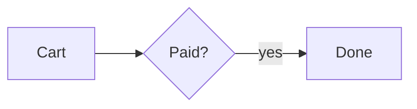
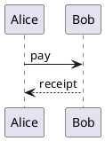
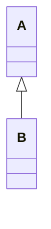

# Shop architecture

Some prose that is not a diagram.

## Checkout flow



## Payment



```js
console.log("not a diagram");
```

## Classes



## Checkout flow

~~~puml
[Cart] --> [Payment]
~~~
