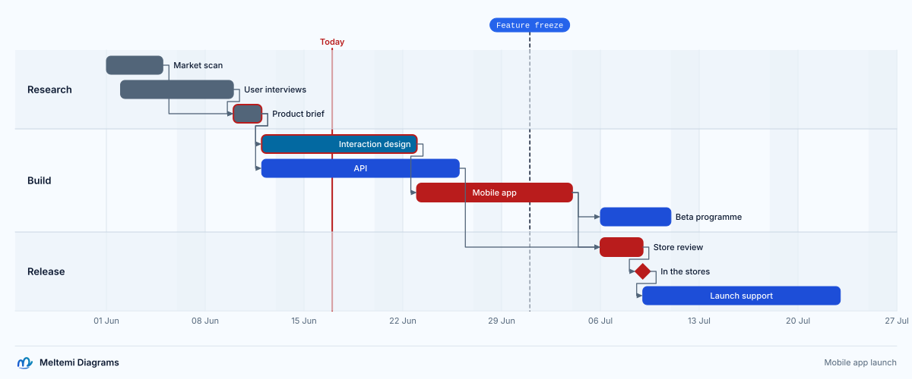

# Diagramas de Gantt

[English](../../language/gantt.md)

Un diagrama de Gantt programa el trabajo sobre un eje de tiempo: secciones de tareas que empiezan
en una fecha o cuando terminan otras tareas, duran una cantidad de días o de horas y se dibujan como
barras sobre un calendario, con hitos y marcas entre ellas. Las fechas y las dependencias deciden
dónde está cada cosa, así que el dibujo nunca necesita coordenadas.

```text
language "0.2"

diagram launch_plan: gantt {
  title "Mobile app launch"
  description "Three sections of tasks with their dependencies, the chain that sets the launch date, a milestone and a marker"
  theme "technical.light"
  axisFormat "%d %b"
  exclude weekends
  today 2026-06-17

  section research "Research" {
    task market "Market scan" from 2026-06-01 for 4d done
    task users "User interviews" from 2026-06-02 for 6d done
    task brief "Product brief" after market, users for 2d done critical
  }

  section build "Build" {
    task ux "Interaction design" after brief for 7d active critical
    task api "API" after brief for 10d
    task app "Mobile app" after ux for 9d critical
    task beta "Beta programme" after app for 5d
  }

  section release "Release" {
    task review "Store review" after app, api for 3d critical
    milestone live "In the stores" after review critical
    task support "Launch support" after live for 2w
  }

  marker freeze "Feature freeze" at 2026-07-01
}
```



Los diagramas de Gantt se compilan en el mismo modelo que los demás perfiles: las
secciones, las tareas, los hitos y las marcas son elementos, y cada `after` es una relación desde la
tarea que nombra hasta la que espera. Los ids, las etiquetas, las descripciones, `class`, `style`,
`rule`, `animate`, `link`, los temas, los preajustes, los lienzos y el marco con el logotipo
funcionan como en los demás perfiles. Sus instrucciones propias están a continuación, y
[la galería](../../../gallery/README.md#gantt-a-mobile-app-launch) tiene esta hoja con sus
exportaciones. `mdg init plan --template roadmap` empieza un proyecto con un diagrama propio y
la historia que lo cuenta ([la línea de comandos](../cli.md#empezar-init)).

## Instrucciones

```text
section <id> ["Label"] { … }
task <id> ["Label"] [from <date>] [after <id>[, <id>…]] [for <duration> | to <date> | until <id>[, <id>…]] [done | active] [critical] [{ … }]
milestone <id> ["Label"] [at <date>] [after <id>[, <id>…]] [done | active] [critical] [{ … }]
marker <id> ["Label"] (at <date> | after <id>[, <id>…]) [{ … }]
```

| Instrucción | Se dibuja como                                                                     |
| ----------- | ---------------------------------------------------------------------------------- |
| `section`   | una banda de filas, con su título en la columna de la izquierda                    |
| `task`      | una barra desde su inicio hasta su final                                           |
| `milestone` | un rombo en un instante                                                            |
| `marker`    | una línea discontinua que cruza el diagrama, con su etiqueta en una píldora arriba |

Una sección contiene tareas, hitos y marcas, nunca otra sección. Las tres también pueden estar en el
nivel superior del diagrama, antes o entre las secciones; las tareas y los hitos que no están en
ninguna sección se dibujan primero, encima de las secciones y sin título. Cada instrucción tiene un
id, único en el diagrama, y la etiqueta que le sigue es el id cuando no se escribe. `id["Label"]` no
declara nada en un diagrama de Gantt: es `prop.unknown`, y el mensaje nombra las cuatro
instrucciones.

Los bloques de una tarea, un hito, una marca y una sección aceptan `description "<text>"`,
`class <id>[, <id>…]`, `link <diagram>.<element>` y `url "<url>"`; el bloque de una sección contiene
además sus instrucciones.

### Cláusulas y palabras de estado

Después de la etiqueta, una instrucción se lee palabra por palabra, en cualquier orden: una palabra
de cláusula toma su valor, una palabra de estado va sola y un bloque termina la instrucción.

| Palabra          | En                 | Significado                                                            |
| ---------------- | ------------------ | ---------------------------------------------------------------------- |
| `from <date>`    | tarea              | el inicio                                                              |
| `at <date>`      | hito, marca        | el instante                                                            |
| `after <ids>`    | tarea, hito, marca | lo que espera: empieza cuando termina la última de esas tareas         |
| `for <duration>` | tarea              | cuánto dura                                                            |
| `to <date>`      | tarea              | su último día, inclusive, o el instante en que termina                 |
| `until <ids>`    | tarea              | termina cuando empieza la primera de ellas                             |
| `done`, `active` | tarea, hito        | el estado; sin ninguna de las dos, la tarea o el hito está planificado |
| `critical`       | tarea, hito        | en la ruta crítica: lleva un borde del `danger` del tema               |

- Una lista de ids llega hasta la siguiente palabra de cláusula o de estado, y las comas entre sus
  ids son opcionales: `after design, review`.
- Una tarea tiene un solo final: `for`, `to` y `until` se excluyen entre sí, y la segunda que se
  escribe es `prop.duplicate`. También lo es una cláusula escrita dos veces, y también `done` con
  `active`.
- Un hito acepta `at` y `after`; una marca, una de las dos: una marca sin ninguna es
  `prop.invalid-value` y con las dos, `prop.duplicate`. `from`, `for`, `to` y `until` en un hito son
  `prop.unknown`, con la pista de que pertenecen a las tareas.
- Una palabra que no es cláusula ni estado de la instrucción es `prop.unknown`, y la pista enumera
  las palabras que acepta. Una cláusula sin su valor es `prop.invalid-value`.
- Las palabras `from`, `after`, `for`, `to`, `until`, `at`, `done`, `active` y `critical` no pueden
  ser ids, para que una lista de ids termine en la siguiente cláusula: `prop.invalid-value`, con la
  pista de cambiarles el nombre.
- La barra de una tarea se dibuja con el color de su estado: planificada, con el `accent` del tema;
  en curso, con `info`; hecha, con `muted`.

## Fechas y duraciones

Una fecha se escribe sin comillas, en una de estas formas, en tiempo civil: el mismo instante en
todas las máquinas, sin zona horaria ni horario de verano.

| Escrito               | Significa                            |
| --------------------- | ------------------------------------ |
| `2026-06-01`          | el día completo, desde su medianoche |
| `2026-06-01T09:30`    | ese instante                         |
| `2026-06-01T09:30:15` | ese instante, con segundos           |

El analizador léxico la lee como un solo token, así que el formateador la imprime tal como se
escribió. Otra escritura (`2026-6-1`, `20260601`, la cadena `"2026-06-01"` entre comillas) es
`prop.invalid-value`, y su pista da las dos formas; una fecha que tiene la forma pero no nombra
ningún día del calendario gregoriano dice por qué: de `2026-02-30` dice que febrero de 2026 tiene 28
días, y una hora superior a 23 o un minuto o un segundo superior a 59 se rechazan igual. Los años
bisiestos cuentan: `from 2028-02-28 for 2d` termina el 1 de marzo.

Una duración es un número mayor que 0 con una unidad, y admite decimales: `10d`, `1.5h`, `30min`.

| Unidad | Es                                                                                |
| ------ | --------------------------------------------------------------------------------- |
| `s`    | segundos                                                                          |
| `min`  | minutos                                                                           |
| `h`    | horas                                                                             |
| `d`    | días: 24 horas, o un día hábil cuando el diagrama excluye días                    |
| `w`    | semanas: 7 días, o los días hábiles de una semana cuando el diagrama excluye días |

`0d`, un número negativo, un número sin unidad o con otra unidad (`5days`) y una duración de más de
un siglo son `prop.invalid-value`; el mensaje enumera las unidades y, para un cero, la pista dice
que declares un `milestone`. Los meses y los años no son duraciones, porque su largo depende de
dónde empiezan: escribe los días. `mo` y `y` existen solo como intervalos de `ticks`.

## El calendario

```text
exclude weekends                // los sábados y los domingos no se trabajan
exclude friday                  // ni ningún otro día de la semana que se escriba
exclude 2026-12-24, 2026-12-25  // ni estas fechas
include 2026-06-06              // un día hábil a pesar de las exclusiones
weekStart sunday                // las divisiones semanales empiezan el domingo (el lunes por defecto)
```

- `exclude` acepta `weekends`, los días de la semana (`monday` a `sunday`) y fechas, varios en una
  instrucción, y varias instrucciones se suman. Cualquier otra cosa es `prop.invalid-value`, y la
  pista enumera lo que acepta `exclude`; también lo son una fecha con hora, porque se excluyen
  días, y una lista que excluiría los siete días de la semana.
- `include` convierte fechas en días hábiles a pesar de las exclusiones. Una fecha que nada excluye
  ya es un día hábil: `prop.invalid-value`.
- `weekStart` es el primer día de la semana para las divisiones semanales.
- Con exclusiones, las duraciones cuentan tiempo hábil. Un día excluido no aporta nada: `5d` desde un
  lunes termina al final del viernes, una semana son `7 − los días de la semana excluidos` días
  (`2w` son diez días hábiles con `exclude weekends`), y `h`, `min` y `s` cuentan solo las horas de
  los días hábiles. El tiempo excluido dentro de una tarea no parte su barra.

| Diagrama y tarea                                                      | La tarea                                        |
| --------------------------------------------------------------------- | ----------------------------------------------- |
| `exclude weekends`, `from 2026-06-08 for 10d`                         | termina al final del viernes 19 de junio        |
| `exclude weekends`, `from 2026-06-01 for 2w`                          | termina al final del viernes 12 de junio        |
| `exclude weekends, 2026-06-03`, `include 2026-06-06`, `from … for 5d` | cubre el 1, 2, 4, 5 y 6 de junio                |
| `exclude weekends`, `from 2026-06-05T18:00 for 12h`                   | termina el lunes 8 de junio a las 06:00         |
| `exclude friday, saturday, sunday`, `from 2026-06-01 for 1w`          | termina al final del jueves 4 de junio (4 días) |

## La programación

Las tareas y los hitos se programan en el orden de sus dependencias, sea cual sea su orden en el
archivo.

**Inicio.**

- `from <date>` solo empieza ahí, y `after a, b` solo empieza cuando termina la última de `a` y `b`.
- Las dos juntas empiezan en la más tardía de las dos: junto a `after`, `from` es un "no antes de", y
  es lo que escribe un arrastre en el lienzo cuando una barra dependiente se mueve hacia adelante en
  el tiempo.
- Sin ninguna, una tarea o un hito empieza donde termina la tarea o el hito anterior del archivo,
  entre secciones (las marcas no cuentan). El primero no tiene nada a lo que seguir:
  `gantt.unscheduled`.
- Un inicio en tiempo excluido pasa al siguiente instante hábil. Un `from` o un `at` escritos lo
  dicen con `gantt.excluded-day` (advertencia), que nombra el día al que pasa; un inicio que resulta
  de `after` pasa sin decir nada.

**Final.**

- `for <duration>` suma tiempo hábil al inicio.
- `to <date>` termina al final de ese día, inclusive (`from 2026-06-01 to 2026-06-05` son cinco
  días), y `to <date>T<time>` en ese instante. En un día excluido termina al final del último día
  hábil anterior, con `gantt.excluded-day`.
- `until a, b` termina cuando empieza la primera de ellas.
- Una tarea sin cláusula de final dura un día, un día hábil con exclusiones, y no informa nada.
- Un hito es su inicio. Una marca está en su fecha `at`, o al final de la última de sus tareas
  `after`; una marca nunca se mueve ni da advertencias, porque puede marcar un fin de semana.

**Comprobaciones.**

| Código               | Cuándo                                                                                                        |
| -------------------- | ------------------------------------------------------------------------------------------------------------- |
| `gantt.unscheduled`  | una tarea o un hito no tiene inicio ni nada anterior a lo que seguir                                          |
| `gantt.schedule`     | una tarea termina antes de empezar (o cuando empieza), o el calendario no le deja tiempo hábil                |
| `gantt.cycle`        | `after` y `until` vuelven a una tarea: se informa en cada referencia del ciclo, y las demás como relacionadas |
| `gantt.relation`     | una instrucción de relación (`a -> b`): las dependencias se escriben con `after`                              |
| `gantt.excluded-day` | advertencia: una fecha escrita en un día excluido, y el día al que pasa                                       |

Una tarea que no se puede fechar, y las que la esperan, no tienen fechas y no se dibujan; solo se
informa la causa. El **lapso** del diagrama va del primer inicio al último final de sus tareas,
hitos y marcas.

## Dependencias

`after` y `until` nombran tareas e hitos del diagrama. Una sección o una marca es
`prop.invalid-value` ("`after` nombra tareas e hitos"), y un id desconocido es
`ref.unknown-element` con los ids parecidos como candidatos. Cada id de `after` es una relación
derivada desde esa tarea hasta la que espera, con la clave `<pred>-><task>#<n>` (`tec0->tec1#1`), y
se dibuja como una flecha; `until` no dibuja ninguna. Los nombres son referencias con el rol
`dependency`, así que la definición, las referencias y el cambio de nombre las siguen, y quitar una
tarea las encuentra.

```text
task design "Design" from 2026-06-01 for 5d
task build "Build" after design for 10d        // empieza cuando design termina
task docs "Docs" after design from 2026-06-15  // no antes del 15 de junio, ni antes de que design termine
task qa "QA" after build, docs until launch    // termina cuando launch empieza
milestone launch "Launch" at 2026-07-06
```

Una instrucción de relación no es una dependencia: `design -> build` es `gantt.relation`, con la
pista y la corrección rápida de escribir `after design` en `build`.

## Propiedades del diagrama

| Instrucción                        | Valor                                                                                  | Valor por defecto                 |
| ---------------------------------- | -------------------------------------------------------------------------------------- | --------------------------------- |
| `title "…"`, `description "…"`     | el título y la descripción del SVG; el título también va en el marco con el logotipo   | ninguno                           |
| `theme`, `preset`, `canvas (w, h)` | como en los demás perfiles ([styles.md](styles.md#preajustes-y-lienzo))                | el tema del proyecto              |
| `axisFormat "<format>"`            | las etiquetas del eje, con las directivas de abajo                                     | sigue al intervalo                |
| `ticks <n><unit>`                  | el intervalo del eje: `s`, `min`, `h`, `d`, `w`, `mo` o `y` tras un número entero      | se elige según el lapso           |
| `axis top\|bottom\|both`           | dónde van las etiquetas del eje                                                        | `bottom`                          |
| `labels bar\|column`               | las etiquetas de las tareas sobre o junto a sus barras, o en la columna bajo el título | `bar`                             |
| `display normal\|compact`          | una fila por tarea, o las tareas agrupadas en el menor número de filas                 | `normal`                          |
| `dependencies shown\|hidden`       | si se dibujan las flechas                                                              | `shown`                           |
| `dayWidth <n>`                     | las unidades de ancho de un día, de 1 a 100 000                                        | el diagrama llena su lienzo       |
| `today [<date>]`                   | una línea en el día en que se hace el dibujo, o en una fecha                           | sin línea                         |
| `exclude`, `include`, `weekStart`  | el calendario ([arriba](#el-calendario))                                               | todos los días se trabajan, lunes |

Cada una se escribe una sola vez, salvo `exclude` e `include`, que se suman: un segundo `today` o
`axis` es `prop.duplicate`. Un valor fuera de su lista o de su rango es `prop.invalid-value` y el
mensaje dice lo que se acepta.

`axisFormat` es un subconjunto de strftime. Cada directiva puede llevar la bandera `-`, que omite su
relleno (`%-d` es `1`), y los nombres de los meses y de los días de la semana están en el idioma del
proyecto (`01 Jun`, `01 jun`); una directiva desconocida es `prop.invalid-value` y las enumera.

| Directiva | Imprime                                       | Directiva | Imprime                                 |
| --------- | --------------------------------------------- | --------- | --------------------------------------- |
| `%a`      | el día de la semana, abreviado                | `%A`      | el día de la semana                     |
| `%b`      | el mes, abreviado                             | `%B`      | el mes                                  |
| `%d`      | el día del mes, de 01 a 31                    | `%e`      | lo mismo, rellenado con un espacio      |
| `%H`      | la hora, de 00 a 23                           | `%I`      | la hora, de 01 a 12                     |
| `%j`      | el día del año, de 001 a 366                  | `%m`      | el mes, de 01 a 12                      |
| `%M`      | el minuto, de 00 a 59                         | `%S`      | el segundo, de 00 a 59                  |
| `%p`      | AM o PM                                       | `%q`      | el trimestre, de 1 a 4                  |
| `%U`      | la semana del año, desde el domingo, desde 00 | `%W`      | lo mismo, desde el lunes                |
| `%V`      | la semana ISO, de 01 a 53                     | `%w`      | el día de la semana, de 0 (domingo) a 6 |
| `%y`      | el año sin el siglo                           | `%Y`      | el año                                  |
| `%%`      | un signo de porcentaje                        |           |                                         |

### Hoy

`today` dibuja una línea en el día en que se hace el dibujo, y `today 2026-06-17`, en esa fecha. La
línea se dibuja solo cuando el día está dentro del lapso, que nunca ensancha, y un diagrama sin
`today` no tiene ninguna.

La disposición nunca lee un reloj: el host le pasa el día como `LayoutOptions.today`, un texto
`YYYY-MM-DD`. El editor y la app web pasan su propia fecha local, y la línea de comandos la de la
máquina, o la de `--today`:

```bash
mdg export plan.meltemi --today 2026-07-15
```

`--today` da el mismo día a todos los diagramas de la ejecución que escriben `today` sin fecha, en
todos los formatos, así que un dibujo hecho en la integración continua no cambia con el día en que
se hace; un `today <date>` escrito en el diagrama prevalece. Un valor que no es una fecha es un
error de uso. Sin el día, la línea `today` de un diagrama no se dibuja.

## Disposición

Los diagramas de Gantt se disponen sin motor, de forma determinista: el mismo texto, tema, idioma y
día dan el mismo dibujo. Una tarea, un hito o una marca sin fechas (un ciclo, una tarea sin
programar) no se dibuja y no agrega ningún diagnóstico propio.

- **La escala de tiempo.** La línea de tiempo va del primer inicio al último final de las
  instrucciones con fecha, ampliada hasta divisiones completas. Un `dayWidth` escrito le da esas
  unidades por día; sin él, la línea de tiempo llena el lienzo, 1200 unidades con `preset document`
  y sin preajuste, 1920 con `slide` o el ancho de un `canvas` escrito, menos la columna de las
  secciones y los márgenes, y 960 unidades propias en un `board`. Un diagrama que `dayWidth` hace
  más ancho que un preajuste o un `canvas` escritos informa `layout.too-large`, como cualquier
  diagrama.
- **Divisiones.** El intervalo es el menor de la escala 1, 5, 15 y 30 s; 1, 5, 15 y 30 min; 1, 3, 6
  y 12 h; 1 y 2 d; 1 y 2 w; 1, 3 y 6 mo; y 1, 2, 5 y 10 y cuyas divisiones dan cabida a la etiqueta
  más ancha más 12 unidades. Las semanas empiezan en `weekStart`, los meses el día 1 y los años el 1
  de enero. Un `ticks` escrito fija el intervalo (se duplica cuando dibujaría más de 4000
  divisiones); cuando sus etiquetas chocarían, se etiqueta una de cada n y `layout.ticks-crowded`
  (advertencia) nombra n en la instrucción.
- **Etiquetas del eje.** `axisFormat`, o un formato que sigue al intervalo: `%H:%M:%S` para
  segundos, `%H:%M` por debajo de un día, `%d %b` hasta dos semanas, `%b %Y` hasta seis meses y `%Y`
  más allá. Un eje automático nunca elige divisiones más finas de lo que distinguen las directivas
  escritas: `%b` nombra meses, así que las divisiones distan al menos un mes y ninguna etiqueta se
  repite. Una etiqueta en un extremo del eje se corre hacia adentro para quedar en el lienzo, y
  `axis` pone las etiquetas bajo las filas, sobre ellas o en ambos lados.
- **Secciones y filas.** La columna de la izquierda contiene el título de cada sección con el
  `groupTitleSize` y el `labelWeight` del tema, ajustado a 280 unidades, y es tan ancha como el
  título más ancho más dos veces `padding`, de 120 como mínimo. Cada tarea y cada hito ocupa una
  fila, con una barra de `round(24 × relationLabelSize / 11)` de alto (24 con el tamaño 11) en un
  paso de eso más 8; una sección agrega 8 arriba y abajo de sus filas. Las secciones dibujan una
  banda `band` al 60 % de opacidad una de cada dos, la primera, la tercera y así, con una línea
  `bandLine` entre secciones, de modo que la cuadrícula y los días excluidos se vean a través; el
  `fill` y el `stroke` de una sección dan estilo a esa banda. `display compact` pone cada tarea de
  una sección, en el orden del código fuente, en la primera fila donde su barra y su etiqueta no se
  superponen con nada. Una marca no ocupa ninguna fila.
- **Barras y etiquetas.** Una barra va de su inicio a su final, con las esquinas
  `min(radius, height / 4)`, rellena según el estado (`accent`, `info`, `muted`); `critical` la
  traza en `danger` con ancho 2 y rellena con `danger` una planificada. La etiqueta, con
  `relationLabelSize` y peso 500, va dentro de la barra en `tagText` cuando cabe con 8 unidades a
  cada lado, si no después de la barra en `ink` cuando la barra termina dentro de la línea de
  tiempo, y si no antes de ella. Una etiqueta se mantiene a 6 unidades de su barra, a 14 cuando sale
  una flecha de ella, y queda a la izquierda de la flecha que entra en su barra; nunca queda sobre
  una flecha, la línea de una marca o la línea de hoy cuando hay otro lugar libre, y el diagrama
  crece hacia la derecha para una etiqueta que no tiene ningún lugar libre dentro de la línea de
  tiempo. Con `labels column`, las etiquetas van en la columna, a la altura de sus filas bajo el
  título de la sección, y las barras no llevan ninguna.
- **Hitos y marcas.** Un hito es un rombo de 0,8 veces el alto de la barra, centrado en su
  instante, relleno y trazado como una barra, con su etiqueta a continuación. Una marca es una línea
  discontinua (4 4, 1,5 unidades, `ink`) desde su píldora hasta el eje, detrás de las barras, con su
  etiqueta en una píldora `tag` sobre las filas, escalonadas en carriles para que ninguna toque a
  otra.
- **Hoy y los días excluidos.** La línea de hoy mide 2 unidades de `danger`, con la palabra "Hoy"
  ("Today") encima, en el idioma del proyecto. Los días excluidos son columnas `band` al 60 % de
  opacidad detrás de las filas, que se dibujan cuando un día mide más de 2 unidades de ancho.
- **Flechas de dependencia.** Cada flecha sale del final de su predecesora (el vértice derecho de un
  hito) 8 unidades hacia la derecha, va hasta la fila de la sucesora y entra en su inicio (el vértice
  izquierdo de un hito). Cuando la sucesora empieza a menos de 16 unidades del final, baja hasta el
  hueco entre las filas, vuelve hasta 8 unidades antes del inicio y entra; en la misma fila, como
  permite `display compact`, es una línea recta. Usan el `connector`, el `connectorWidth`, el
  `arrowhead` y las `corners` del tema, se dibujan sobre las barras y reciben su estilo de
  `rule relation { … }`; `dependencies hidden` no dibuja ninguna y el modelo las conserva.
- **Los temas de boceto** dibujan a mano las barras, los rombos, las bandas y las flechas, y dejan
  nítida la cuadrícula.
- **Un diagrama vacío** dibuja cuatro semanas, desde el comienzo de la semana del día que da el
  host.
- **Las comprobaciones de composición** no se aplican: las filas no se pueden superponer. La
  auditoría de etiquetas comprueba cada etiqueta frente a lo que cubre, no frente a su propia barra,
  así que una etiqueta junto a su barra no es un hallazgo.

`LayoutResult.boxes` contiene las barras, los rombos, las líneas de las marcas y las bandas de las
secciones (por id de elemento); `labels`, la caja de cada etiqueta, la píldora de una marca
incluida; `connectors`, las flechas por clave de relación; y `gantt`, la línea de tiempo (`x`,
`width`, `start` y `end` como segundos civiles, y `dayWidth`, las unidades que ocupa un día) y el
`y`, el `height` y la sección de cada fila, que los editores usan para convertir una posición del
puntero en una fecha. En la escena, la cuadrícula, las etiquetas del eje, los días excluidos y la
línea de hoy son un único grupo de rol `axis` (`<g data-id="axis" data-role="axis">`), que los temas
de boceto no vuelven a pintar, que no recibe eventos del puntero y que las historias nunca atenúan.
Cada sección es un grupo de rol `element` cuyo `bounds` es su banda y que contiene los grupos de sus
filas; cada tarea, hito y marca es un grupo de rol `element`, con su `bounds` la barra, el rombo o
la línea y `bounds.label` su etiqueta; cada flecha es un grupo de rol `relation` con su clave y su
ruta.

## Estilos, clases y enlaces

Los bloques de estilo, las clases y las reglas se aplican a tareas, hitos, marcas, secciones y
flechas:

```text
rule task { radius 2 }                  // cada barra
rule marker { stroke danger }           // cada marca
rule relation { stroke muted }          // cada flecha
class late { stroke danger; width 2 }

style live { fill warning }             // un hito
style beta { class late }               // una tarea
```

- `rule` acepta `task`, `milestone`, `marker`, `section` y `relation`.
- Una tarea y un hito aceptan `fill`, `stroke`, `width`, `line`, `color` (el de la etiqueta) y, una
  tarea, `radius`; el `stroke` de una marca colorea su línea y el borde de su píldora, y su `fill` y
  su `color`, la píldora; el `fill` y el `stroke` de una sección, su banda, y su `color`, su título;
  una flecha acepta `stroke`, `width`, `line`, `arrowhead` y `corners`, pero solo mediante
  `rule relation`, ya que las relaciones de un diagrama no tienen id con que nombrarlas.
  `pattern` rellena una barra y un rombo con la trama en el color del trazo; `icon` e `iconColor` se
  aceptan y todavía no se dibujan en las barras.
- `shape`, `rotation`, `iconPosition`, `labelPosition`, `iconSize`, `routing` y las propiedades
  exclusivas de las composiciones libres son `prop.invalid-value` y el mensaje nombra los diagramas
  de Gantt: las barras, los rombos y las líneas tienen una forma fija. `font`, `fontSize` y
  `fontWeight` también son `prop.invalid-value`: las etiquetas de un diagrama de Gantt se dibujan
  con la fuente del tema, al tamaño de sus filas.
- El estado colorea primero una barra y los estilos lo sustituyen: un `fill` escrito reemplaza el
  color del estado.
- `link` y `url` funcionan como en los elementos de los demás perfiles: una tarea que representa un
  elemento de otro diagrama, y una barra que abre una dirección en las exportaciones SVG, PDF y
  HTML.

## Efectos e historias

`pulse` y `dash` aceptan tareas, hitos, marcas y secciones. `flow` y `trace` aceptan una tarea o un
hito que espera a otros, y corren por cada una de sus flechas de entrada:

```text
animate app { effect flow }       // partículas por la flecha de ux a app
animate live { effect pulse }     // un halo alrededor del rombo
```

En una tarea sin dependencias son `animate.invalid-target`: "`market` no tiene flechas de
dependencia que recorrer".

Una historia cuenta un plan con las acciones de [stories.md](stories.md): `reveal`, `hide`,
`highlight`, `focus` y `camera` aceptan secciones, tareas, hitos y marcas como elementos, y dos
acciones conocen los diagramas de Gantt.

- `draw market, users` hace crecer cada barra, con su etiqueta, desde su inicio hasta su final, una
  tras otra en partes del tiempo proporcionales al ancho de las barras, y las deja dibujadas; una
  tarea que `draw` muestra primero empieza oculta. `draw` de una sección, un hito o una marca es
  `story.invalid-target`.
- `trace live` dibuja las flechas de la cadena que determina la tarea o el hito: desde él, la
  predecesora que termina última, y así hasta el comienzo, la más temprana primero, una tras otra,
  cada una en una parte del tiempo proporcional a su longitud. Uno sin dependencias es
  `story.invalid-target`.

Ninguna acción atenúa ni oculta el eje, su cuadrícula ni sus etiquetas, así que una historia puede
empezar con todas las secciones ocultas y la escala de tiempo en su lugar:

```text
story plan for launch_plan {
  scene research "Research" {
    reveal research
    draw market, users, brief over 2s
  }
  scene chain "The chain to the launch" {
    trace live over 2s
  }
}
```

## En el reproductor

En el reproductor HTML ([player.md](../player.md#explorar-un-dibujo)), la tarjeta que aparece al
pasar el puntero sobre una tarea muestra su etiqueta, su sección, su estado (no cuando solo está
planificada) y "Crítica", sus fechas en el idioma del reproductor (`8 jun 2026 → 19 jun 2026`), sus
días hábiles, las tareas a las que sigue (`Después de: Product brief`), su descripción y el host de
su `url`; el panel de detalles enumera Sección, Inicio, Fin, Tiempo hábil y Estado. La tarjeta de un
hito o de una marca muestra su fecha en lugar del intervalo, la de una sección, su intervalo, y la
de una flecha, "predecesora → sucesora". Una tarjeta no muestra ninguna cláusula, comentario ni
diagnóstico, y el eje no recibe eventos del puntero.

## Edición

Las ediciones conservan las fechas que tiene el texto y escriben la cláusula que cambia un gesto
(consulta [editor.md](../editor.md)): arrastrar una barra escribe `from`, arrastrar sus extremos
escribe `for` o `to`, unir dos barras escribe `after`, y mover una fila mueve su instrucción. El
paquete de edición tiene una operación para cada una:

| Operación                                                                                | Escribe                                                                                                                                                                                                   |
| ---------------------------------------------------------------------------------------- | --------------------------------------------------------------------------------------------------------------------------------------------------------------------------------------------------------- |
| `setTaskSchedule { diagram, task, from?, after?, end? }`                                 | el inicio, las dependencias y el final de una tarea, un hito o una marca; un campo ausente conserva su cláusula y `null` la quita; `end` es `{ for: "10d" }`, `{ to: "2026-06-19" }` o `{ until: ["a"] }` |
| `setTaskStatus { diagram, task, status, critical }`                                      | `done` o `active`, y luego `critical`, después de las cláusulas                                                                                                                                           |
| `createTask { diagram, elementKind, id?, label?, parent?, index?, from?, after?, end? }` | una `task`, un `milestone`, un `marker` o una `section` antes de la instrucción que está en `index` de la sección `parent`, o del diagrama; los ids que crea son `task1`, `milestone1`…                   |
| `setCalendar { diagram, exclude, include }`                                              | las instrucciones `exclude` e `include` del diagrama, y elimina la que tiene una lista vacía                                                                                                              |
| `moveElement { diagram, element, parent, index }`                                        | una fila a una sección o al nivel superior antes de la instrucción que está en `index`, o una sección entre las secciones                                                                                 |
| `removeElement`, `renameId`                                                              | una instrucción y sus ids en las listas de `after` y `until`; un id en todos los lugares donde se nombra                                                                                                  |
| `createDiagram { type: "gantt" }`                                                        | un `diagram <id>: gantt { }` vacío                                                                                                                                                                        |

- Solo cambian los tokens de una cláusula: un valor se reemplaza donde está, una cláusula que se
  quita se va con el espacio anterior, una cláusula de inicio nueva va después de las cláusulas de
  inicio escritas (después de la etiqueta, o del id cuando no hay) y una de final nueva, después de
  ellas, y se conservan los comentarios, el bloque y las palabras de estado. Una operación que no
  cambia nada no escribe nada.
- Un destino que no es una tarea, un hito ni una marca es `edit.unsafe-target`. Una fecha o una
  duración mal formada, un final en un hito o una marca, una sección dentro de una sección, un padre
  que no es una sección, un id en uso o una palabra de cláusula como id, y un resultado con un error
  nuevo, un ciclo o un id desconocido, son `edit.invalid-value`; un rechazo que viene de los
  diagnósticos del modelo lleva su código en el `diagnostic` del rechazo (`gantt.cycle` para un
  ciclo), y el texto queda como estaba.
- Quitar una tarea o un hito quita su id de cada `after` y `until`. Una tarea que pierde su última
  cláusula de inicio, y una que empezaba siguiéndola en el archivo, se escriben `from` el inicio que
  tenían, y un `until` que pierde su último id pasa a ser el `for` que duraba la tarea, de modo que
  ninguna otra fecha se mueve; el plan enumera una nota por cada una, y `edit.has-dependents` no se
  produce por las dependencias. Quitar una sección quita sus filas del mismo modo.
- `moveElement` acepta solo `parent` e `index`: se rechaza `at`, y también un índice más allá del
  último lugar. Una sección que se mueve se lleva una de las líneas en blanco que la rodean.
- Las operaciones que colocan o unen cajas (`setPosition`, `createRelation`, `createElement`,
  `groupElements` y las demás) son `edit.invalid-value` en un diagrama de Gantt, y
  `setElementProperty` acepta solo `link` y `url`.

### Servicios del lenguaje

El editor conoce el diagrama como conoce los demás perfiles:

- **La completación** ofrece `gantt` entre los tipos, y un fragmento de un diagrama que empieza el
  día que da el host; en un diagrama, las instrucciones `section`, `task`, `milestone` y `marker`,
  las del propio diagrama y los bloques; en una sección, sus tres instrucciones y sus propiedades;
  tras una etiqueta, las palabras de cláusula y de estado que aún no están escritas; las tareas y
  los hitos, nunca las secciones ni las marcas, tras `after` y `until`, sin la propia instrucción,
  los ids ya listados ni las tareas que la esperan; las unidades tras el número de una duración;
  `weekends` y los días de la semana tras `exclude`, los días de la semana tras `weekStart`; los
  valores de `axis`, `labels`, `display` y `dependencies`; y las directivas dentro de la cadena de
  `axisFormat`.
- **El texto emergente** de una tarea da sus fechas con sus días de la semana y sus días hábiles, a
  qué sigue, qué la sigue y su sección; el de un hito o una marca, su día; el de una sección, los
  días que cubren sus filas y lo que contiene; el de una fecha, su día de la semana y si el
  diagrama la excluye o la trabaja a pesar de las exclusiones; el de una duración, el final que da,
  en días hábiles cuando el diagrama excluye alguno; y el de una palabra del diagrama, lo que
  significa allí, como `from` significa un inicio aquí y el extremo de una ruta en un diagrama de
  flujo.
- **Correcciones rápidas**: `gantt.unscheduled` escribe `from` (`at` en un hito) el día del host;
  `gantt.relation` escribe `after a` en `b` y quita la relación, o solo la quita cuando `b` ya sigue
  a `a`, y no ofrece nada cuando cerraría un ciclo; `gantt.excluded-day` mueve la fecha al siguiente
  día hábil, y la de un final también al anterior; `gantt.cycle` quita la referencia que cierra el
  ciclo de su `after` o su `until`, en cada referencia; `ref.unknown-element` cambia un id mal
  escrito por las tareas parecidas.
- **El esquema** enumera cada sección con sus tareas, hitos y marcas tal como están escritos, y
  ninguna flecha; la definición, las referencias y el cambio de nombre siguen `after` y `until`
  hasta la tarea.
- La gramática de VS Code colorea `gantt`, las cuatro instrucciones, las palabras de cláusula y de
  estado, las instrucciones del diagrama y las fechas.

## Un ejemplo completo

Una hoja de ruta de tres secciones y diez tareas, tal como la escribe `import` a partir de la
fuente de Mermaid:

```text
language "0.2"

diagram hoja_de_ruta_genai: gantt {
  title "Hoja de ruta GenAI"
  axisFormat "%d %b"
  exclude weekends
  today

  section tecnologia "Tecnología" {
    task tec0 "Evaluar plataformas de agentes" from 2026-06-01 for 5d
    task tec1 "Prueba de concepto con el equipo de Arquitectura" after tec0 for 10d
    task tec2 "Presentar resultados al comité Arq" after tec1 for 1d
  }

  section nuevo_flujo_genai_hub "Nuevo Flujo GenAI Hub" {
    task flu0 "Propuesta de flujo ágil de evaluación" from 2026-06-15 for 3d
    task flu1 "Interfaz Evaluación y seguimiento (WebComponent)" after flu0 for 10d
    task flu2 "Integración con LeanIX" after flu1 for 10d
    task flu3 "Marcha Blanca primeros casos de uso" after flu2 for 10d
  }

  section i_d "I+D" {
    task sdlc0 "Estándares de desarrollo Agéntico + GenAI for productivity." from 2026-07-01 for 30d
    task sdlc1 "Workshops AI-SDLC" from 2026-08-03 for 5d
    task sdlc2 "Desarrollo de Skills y Agentes (AI-SDLC)." after sdlc1 for 15d
  }
}
```

Se valida con `Checked 1 file: 0 errors, 0 warnings.` Los fines de semana no se trabajan, así que
una duración en días son días hábiles, y una tarea que espera a otra que termina al final de un
viernes empieza el lunes:

| Tarea   | Empieza    | Último día | Días hábiles |
| ------- | ---------- | ---------- | ------------ |
| `tec0`  | lun 1 jun  | vie 5 jun  | 5            |
| `tec1`  | lun 8 jun  | vie 19 jun | 10           |
| `tec2`  | lun 22 jun | lun 22 jun | 1            |
| `flu0`  | lun 15 jun | mié 17 jun | 3            |
| `flu1`  | jue 18 jun | mié 1 jul  | 10           |
| `flu2`  | jue 2 jul  | mié 15 jul | 10           |
| `flu3`  | jue 16 jul | mié 29 jul | 10           |
| `sdlc0` | mié 1 jul  | mar 11 ago | 30           |
| `sdlc1` | lun 3 ago  | vie 7 ago  | 5            |
| `sdlc2` | lun 10 ago | vie 28 ago | 15           |

El lapso va del lunes 1 de junio al final del viernes 28 de agosto, y el eje se amplía hasta
divisiones semanales completas: del lunes 1 de junio al lunes 31 de agosto, trece semanas, con las
divisiones `01 jun`, `08 jun` … `31 ago` (`01 Jun` … `31 Aug` en un proyecto en inglés) y los fines
de semana sombreados. Diez barras `accent` están en tres secciones, y seis flechas unen `tec0` con
`tec1` y con `tec2`, `flu0` con `flu1`, con `flu2` y con `flu3`, y `sdlc1` con `sdlc2`. Las
etiquetas de `flu2` y `sdlc0` caben dentro de sus barras, la de `sdlc2` queda antes de su barra, que
termina en el borde derecho, y las demás quedan después de las suyas. `today` no dibuja ninguna
línea mientras el día está fuera del lapso; `today 2026-06-17` dibujaría una en la tercera semana.

Cambia una cláusula y el plan la sigue. `for 5d` pasa a `for 7d` en `tec0`, y `tec1` y `tec2`
empiezan dos días hábiles más tarde; `exclude weekends, 2026-06-29` hace que `flu1`, `flu2` y
`flu3` terminen un día hábil más tarde; `from 2026-06-15` escrito junto a `after tec0` en `tec1` la
hace esperar hasta el 15. `mdg review` muestra cada uno de estos cambios como las fechas que se
movieron, con lo que las movió.

## Importar desde Mermaid

`mdg import chart.mmd` escribe el diagrama que dibuja Mermaid. El importador repite la programación
de Mermaid en lugar de copiar su texto, así que las fechas de la hoja son las que muestra Mermaid:

```bash
mdg import chart.mmd
```

- Las fechas pasan a ser ISO 8601, sea cual sea el `dateFormat` del diagrama (se lee cada token de
  dayjs). Una hora se escribe solo cuando no es la medianoche, la zona horaria se descarta, y lo que
  un formato sin año o sin día deja abierto sale del día de la importación.
- Las fechas finales de Mermaid son exclusivas y `to` es inclusiva: con `dateFormat DD/MM/YYYY`,
  `Design :d1, 01/06/2026, 06/06/2026` pasa a ser `from 2026-06-01 to 2026-06-05`, e
  `inclusiveEndDates` deja la fecha como está.
- `1w` con días de la semana excluidos pasa a ser `7d`, que es como lo cuenta Mermaid; los meses y
  los años (`1M`, `1y`) pasan a ser los días que Mermaid dibuja para ellos; un hito queda en la
  mitad de su intervalo.
- `excludes`, `includes`, `weekend`, `weekday`, `axisFormat`, `tickInterval`, `topAxis` y el
  `displayMode` compacto pasan a ser `exclude`, `include`, `weekStart`, `axisFormat`, `ticks`,
  `axis both` y `display compact`. Un diagrama sin `todayMarker` escribe `today`, porque Mermaid
  dibuja esa línea salvo que se desactive.
- `done`, `active` y `crit` pasan a ser `done`, `active` y `critical`; la etiqueta `milestone` pasa
  a ser un `milestone` y la etiqueta `vert`, una `marker`; `click id href "…"` pasa a ser la `url`
  de la tarea, y `click id call …` se descarta.
- Una tarea cuyas fechas Meltemi resuelve de otro modo que Mermaid, como un inicio en un día
  excluido, que pasa al siguiente día hábil, se informa una vez como `import.approximated`
  (`gantt.schedule`) con las dos fechas.

El plan de arriba se importa sin ningún hallazgo. Una segunda importación con `--merge` conserva lo
que la hoja ha fijado para el aspecto del diagrama (`axisFormat`, `ticks`, `weekStart`, `axis`,
`labels`, `display`, `dependencies` y `dayWidth`) y sus estilos, y toma la programación, `exclude`,
`include` y `today` del origen. `ImportOptions.today`, el día de la máquina por defecto, ubica lo
que Mermaid deja abierto: una tarea sin nada tras lo que empezar, un `dateFormat` sin día. Cada
construcción, con su estado, está en [docs/import/mermaid.md](../import/mermaid.md), y
[from-mermaid.md](../tracks/from-mermaid.md) recorre el paso.
