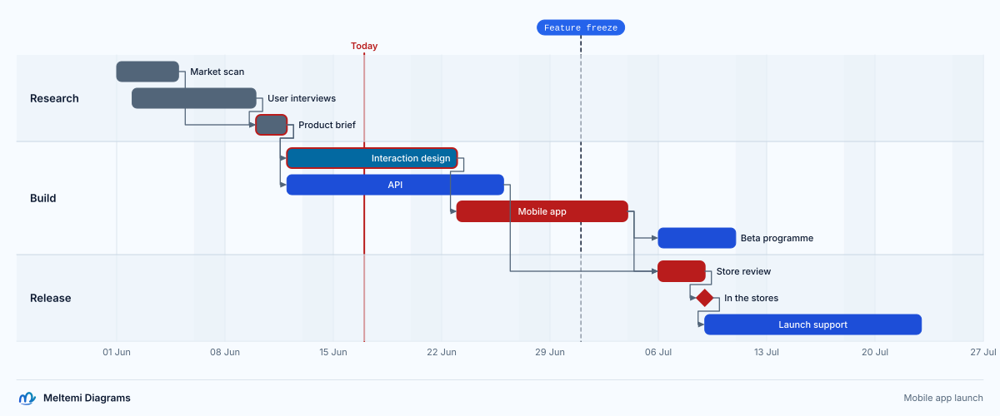

# Gantt charts

[Español](../es/language/gantt.md)

A gantt chart schedules work on a time axis: sections of tasks that start on a date or when other
tasks end, last a number of days or hours and are drawn as bars on a calendar, with milestones and
markers among them. The dates and the dependencies decide where everything stands, so the drawing
never needs coordinates.

```text
language "0.2"

diagram launch_plan: gantt {
  title "Mobile app launch"
  description "Three sections of tasks with their dependencies, the chain that sets the launch date, a milestone and a marker"
  theme "technical.light"
  axisFormat "%d %b"
  exclude weekends
  today 2026-06-17

  section research "Research" {
    task market "Market scan" from 2026-06-01 for 4d done
    task users "User interviews" from 2026-06-02 for 6d done
    task brief "Product brief" after market, users for 2d done critical
  }

  section build "Build" {
    task ux "Interaction design" after brief for 7d active critical
    task api "API" after brief for 10d
    task app "Mobile app" after ux for 9d critical
    task beta "Beta programme" after app for 5d
  }

  section release "Release" {
    task review "Store review" after app, api for 3d critical
    milestone live "In the stores" after review critical
    task support "Launch support" after live for 2w
  }

  marker freeze "Feature freeze" at 2026-07-01
}
```



Gantt charts compile into the same model as the other profiles (decision 0066): sections, tasks,
milestones and markers are elements, and each `after` is a relation from the task it names to the
one that waits. Ids, labels, descriptions, `class`, `style`, `rule`, `animate`, `link`, themes,
presets, canvases and the brand frame work as in the other profiles. Their own statements are
below, and [the gallery](../../gallery/README.md#gantt-a-mobile-app-launch) has this sheet with its
exports. `pnpm mdg init plan --template roadmap` starts a project with a chart of its own and the
story that tells it ([the command line](../cli.md#starting-init)).

## Statements

```text
section <id> ["Label"] { … }
task <id> ["Label"] [from <date>] [after <id>[, <id>…]] [for <duration> | to <date> | until <id>[, <id>…]] [done | active] [critical] [{ … }]
milestone <id> ["Label"] [at <date>] [after <id>[, <id>…]] [done | active] [critical] [{ … }]
marker <id> ["Label"] (at <date> | after <id>[, <id>…]) [{ … }]
```

| Statement   | Drawn as                                                           |
| ----------- | ------------------------------------------------------------------ |
| `section`   | a band of rows, its title in the column at the left                |
| `task`      | a bar from its start to its end                                    |
| `milestone` | a diamond at one instant                                           |
| `marker`    | a dashed line across the chart, its label in a pill above the rows |

A section holds tasks, milestones and markers, never another section. The three may also stand at
the top level of the chart, before or between sections; the tasks and milestones outside any
section are drawn first, above the sections, without a title. Every statement has an id, unique in
the chart, and the label after it defaults to the id. `id["Label"]` declares nothing in a chart:
it is `prop.unknown`, and the message names the four statements.

The blocks of a task, a milestone, a marker and a section take `description "<text>"`,
`class <id>[, <id>…]`, `link <diagram>.<element>` and `url "<url>"`; a section's block holds its
statements too.

### Clauses and status words

After the label, a statement is read word by word, in any order: a clause word takes its value, a
status word stands alone and a block ends the statement.

| Word             | On                      | Meaning                                                      |
| ---------------- | ----------------------- | ------------------------------------------------------------ |
| `from <date>`    | task                    | the start                                                    |
| `at <date>`      | milestone, marker       | the instant                                                  |
| `after <ids>`    | task, milestone, marker | what it waits for: it starts when the last of them ends      |
| `for <duration>` | task                    | how long it lasts                                            |
| `to <date>`      | task                    | its last day, inclusive, or the instant it ends              |
| `until <ids>`    | task                    | it ends when the first of them starts                        |
| `done`, `active` | task, milestone         | the status; without either, the task or milestone is planned |
| `critical`       | task, milestone         | on the critical path: it is stroked in the theme's `danger`  |

- A list of ids runs up to the next clause or status word, and the commas between its ids are
  optional: `after design, review`.
- A task has one end: `for`, `to` and `until` exclude each other, and the second one written is
  `prop.duplicate`. So is a clause written twice, and so is `done` with `active`.
- A milestone takes `at` and `after`, a marker one of them: a marker with neither is
  `prop.invalid-value`, and with both `prop.duplicate`. `from`, `for`, `to` and `until` on a
  milestone are `prop.unknown`, with the hint that they belong to tasks.
- A word that is no clause or status of the statement is `prop.unknown`, and the hint lists the
  words it takes. A clause without its value is `prop.invalid-value`.
- The words `from`, `after`, `for`, `to`, `until`, `at`, `done`, `active` and `critical` cannot be
  ids, so that a list of ids ends at the next clause: `prop.invalid-value`, with the hint to
  rename.
- The bar of a task is drawn in the colour of its status: planned in the theme's `accent`, active in
  `info` and done in `muted`.

## Dates and durations

A date is written without quotes, in one of these forms, in civil time: the same instant on every
machine, with no zone and no daylight saving.

| Written               | Means                            |
| --------------------- | -------------------------------- |
| `2026-06-01`          | the whole day, from its midnight |
| `2026-06-01T09:30`    | that instant                     |
| `2026-06-01T09:30:15` | that instant, with seconds       |

The lexer reads it as one token, so the formatter prints it as written. Another spelling
(`2026-6-1`, `20260601`, a quoted `"2026-06-01"`) is `prop.invalid-value`, and its hint gives the
two forms; a date that has the form and names no day of the Gregorian calendar says why:
`2026-02-30` is "February 2026 has 28 days", and an hour above 23 or a minute or second above 59
is refused the same way. Leap years count: `from 2028-02-28 for 2d` ends on 1 March.

A duration is a number above 0 with a unit, decimals allowed: `10d`, `1.5h`, `30min`.

| Unit  | Is                                                                        |
| ----- | ------------------------------------------------------------------------- |
| `s`   | seconds                                                                   |
| `min` | minutes                                                                   |
| `h`   | hours                                                                     |
| `d`   | days: 24 hours, or a working day when the chart excludes days             |
| `w`   | weeks: 7 days, or the working days of a week when the chart excludes days |

`0d`, a negative number, a number without a unit or with another unit (`5days`), and a duration
longer than a century are `prop.invalid-value`; the message lists the units, and for a zero the
hint says to declare a `milestone`. Months and years are not durations, since their length depends
on where they start: write the days. `mo` and `y` exist as `ticks` intervals only.

## The calendar

```text
exclude weekends                // Saturday and Sunday are not worked
exclude friday                  // nor is any weekday written
exclude 2026-12-24, 2026-12-25  // nor are these dates
include 2026-06-06              // a working day despite the exclusions
weekStart sunday                // weekly ticks begin on Sunday (Monday by default)
```

- `exclude` takes `weekends`, weekdays (`monday` to `sunday`) and dates, several in one statement,
  and several statements add up. Anything else is `prop.invalid-value`, and the hint lists what
  `exclude` takes; so are a date with a time, since days are excluded, and a list that would
  exclude all seven weekdays.
- `include` makes dates working days despite the exclusions. A date that nothing excludes is a
  working day already: `prop.invalid-value`.
- `weekStart` is the first day of the week for weekly ticks.
- With exclusions, durations count working time. An excluded day contributes nothing: `5d` from a
  Monday ends at the end of Friday, a week is `7 − the weekdays excluded` days (`2w` is ten working
  days under `exclude weekends`), and `h`, `min` and `s` count the hours of working days only.
  Excluded time inside a task does not split its bar.

| Chart and task                                                        | The task                                    |
| --------------------------------------------------------------------- | ------------------------------------------- |
| `exclude weekends`, `from 2026-06-08 for 10d`                         | ends at the end of Friday 19 June           |
| `exclude weekends`, `from 2026-06-01 for 2w`                          | ends at the end of Friday 12 June           |
| `exclude weekends, 2026-06-03`, `include 2026-06-06`, `from … for 5d` | covers 1, 2, 4, 5 and 6 June                |
| `exclude weekends`, `from 2026-06-05T18:00 for 12h`                   | ends on Monday 8 June at 06:00              |
| `exclude friday, saturday, sunday`, `from 2026-06-01 for 1w`          | ends at the end of Thursday 4 June (4 days) |

## The schedule

Tasks and milestones are scheduled in dependency order, whatever their order in the file.

**Start.**

- `from <date>` alone starts there, and `after a, b` alone starts when the later of `a` and `b`
  ends.
- Both together start at the later of the two: `from` is a "not before" beside `after`, and what a
  drag on the canvas writes when a dependent bar moves later.
- With neither, a task or milestone starts where the previous task or milestone of the file ends,
  across sections (markers do not count). The first one has nothing to follow: `gantt.unscheduled`.
- A start on excluded time moves to the next working instant. A written `from` or `at` says so with
  `gantt.excluded-day` (warning), naming the day it moves to; a start that follows from `after`
  moves without a word.

**End.**

- `for <duration>` adds working time to the start.
- `to <date>` ends at the end of that day, inclusive (`from 2026-06-01 to 2026-06-05` is five
  days), and `to <date>T<time>` at that instant. On an excluded day it ends at the end of the last
  working day before it, with `gantt.excluded-day`.
- `until a, b` ends when the first of them starts.
- A task with no end clause lasts one day, a working day under exclusions, and reports nothing.
- A milestone is its start. A marker is at its `at` date, or at the end of the latest of its `after`
  tasks; a marker is never moved or warned about, since it may mark a weekend.

**Checks.**

| Code                 | When                                                                                                    |
| -------------------- | ------------------------------------------------------------------------------------------------------- |
| `gantt.unscheduled`  | a task or milestone has no start and nothing before it to follow                                        |
| `gantt.schedule`     | a task ends before it starts (or when it starts), or the calendar leaves no working time for it         |
| `gantt.cycle`        | `after` and `until` lead back to a task: reported on every reference of the loop, the others as related |
| `gantt.relation`     | a relation statement (`a -> b`): dependencies are written with `after`                                  |
| `gantt.excluded-day` | warning: a written date on an excluded day, and the day it moves to                                     |

A task that cannot be dated, and the ones that wait for it, have no dates and are not drawn; only
the cause is reported. The **span** of the chart runs from the earliest start to the latest end of
its tasks, milestones and markers.

## Dependencies

`after` and `until` name tasks and milestones of the chart. A section or a marker is
`prop.invalid-value` ("`after` names tasks and milestones"), and an unknown id is
`ref.unknown-element` with the close ids as candidates. Each `after` id is a derived relation from
that task to the one that waits, keyed `<pred>-><task>#<n>` (`tec0->tec1#1`), and is drawn as an
arrow; `until` draws none. The names are references with the role `dependency`, so definition,
references and rename follow them, and removing a task finds them.

```text
task design "Design" from 2026-06-01 for 5d
task build "Build" after design for 10d        // starts when design ends
task docs "Docs" after design from 2026-06-15  // not before 15 June, nor before design ends
task qa "QA" after build, docs until launch    // ends when launch starts
milestone launch "Launch" at 2026-07-06
```

A relation statement is not a dependency: `design -> build` is `gantt.relation`, with the hint and
quick fix of writing `after design` on `build`.

## Chart properties

| Statement                          | Value                                                                                 | Default                    |
| ---------------------------------- | ------------------------------------------------------------------------------------- | -------------------------- |
| `title "…"`, `description "…"`     | the SVG's title and description; the title is also in the brand frame                 | none                       |
| `theme`, `preset`, `canvas (w, h)` | as in the other profiles ([styles.md](styles.md#presets-and-canvas))                  | the project's theme        |
| `axisFormat "<format>"`            | the labels of the axis, with the directives below                                     | follows the interval       |
| `ticks <n><unit>`                  | the interval of the axis: `s`, `min`, `h`, `d`, `w`, `mo` or `y` after a whole number | chosen from the span       |
| `axis top\|bottom\|both`           | where the tick labels stand                                                           | `bottom`                   |
| `labels bar\|column`               | the task labels on or beside their bars, or in the column under the section's title   | `bar`                      |
| `display normal\|compact`          | a row for every task, or tasks packed into the fewest rows                            | `normal`                   |
| `dependencies shown\|hidden`       | whether the arrows are drawn                                                          | `shown`                    |
| `dayWidth <n>`                     | the units a day is wide, 1 to 100,000                                                 | the chart fills its canvas |
| `today [<date>]`                   | a line at the day the picture is made, or at a date                                   | no line                    |
| `exclude`, `include`, `weekStart`  | the calendar ([above](#the-calendar))                                                 | every day works, Monday    |

Each is set once, except `exclude` and `include`, which add up: a second `today` or `axis` is
`prop.duplicate`. A value outside its list or range is `prop.invalid-value` and the message says
what is accepted.

`axisFormat` is a strftime subset. Each directive may carry the `-` flag, which leaves out its
padding (`%-d` is `1`), and month and weekday names are in the project's language (`01 Jun` in
English, `01 jun` in Spanish); an unknown directive is `prop.invalid-value` and lists these.

| Directive | Prints                                      | Directive | Prints                        |
| --------- | ------------------------------------------- | --------- | ----------------------------- |
| `%a`      | the weekday, short                          | `%A`      | the weekday                   |
| `%b`      | the month, short                            | `%B`      | the month                     |
| `%d`      | the day of the month, 01 to 31              | `%e`      | the same, padded with a space |
| `%H`      | the hour, 00 to 23                          | `%I`      | the hour, 01 to 12            |
| `%j`      | the day of the year, 001 to 366             | `%m`      | the month, 01 to 12           |
| `%M`      | the minute, 00 to 59                        | `%S`      | the second, 00 to 59          |
| `%p`      | AM or PM                                    | `%q`      | the quarter, 1 to 4           |
| `%U`      | the week of the year, Sunday first, from 00 | `%W`      | the same, Monday first        |
| `%V`      | the ISO week, 01 to 53                      | `%w`      | the weekday, 0 (Sunday) to 6  |
| `%y`      | the year without its century                | `%Y`      | the year                      |
| `%%`      | a percent sign                              |           |                               |

### Today

`today` draws a line at the day the picture is made, and `today 2026-06-17` at that date. The line
is drawn only when the day is inside the span, which it never widens, and a chart without `today`
has none.

The layout never reads a clock: the host passes the day as `LayoutOptions.today`, a `YYYY-MM-DD`
text. The editor and the web app pass their own local date, and the command line the machine's,
or the date of `--today`:

```bash
pnpm mdg export plan.meltemi --today 2026-07-15
```

`--today` gives every chart of the run that writes `today` without a date the same day, in every
format, so a picture made in continuous integration does not change with the day it is made; a
`today <date>` written in the chart wins. A value that is not a date is a usage error. Without the
day, a chart's `today` line is not drawn.

## Layout

Gantt charts are laid out without an engine, deterministically: the same text, theme, language and
day give the same picture. A task, milestone or marker without dates (a loop, an unscheduled one)
is not drawn and adds no diagnostic of its own.

- **The time scale.** The timeline runs from the earliest start to the latest end of the dated
  statements, extended to whole ticks. A written `dayWidth` makes it that many units a day; without
  it the timeline fills the canvas, 1,200 units on `preset document` and without a preset, 1,920 on
  `slide` or the width of a written `canvas`, less the section column and the margins, and 960
  units of its own on a `board`. A chart that `dayWidth` makes wider than a written preset or
  `canvas` reports `layout.too-large`, as any diagram does.
- **Ticks.** The interval is the smallest of the ladder 1, 5, 15 and 30 s; 1, 5, 15 and 30 min; 1,
  3, 6 and 12 h; 1 and 2 d; 1 and 2 w; 1, 3 and 6 mo; and 1, 2, 5 and 10 y whose ticks hold the
  widest label plus 12 units. Weeks begin on `weekStart`, months on the 1st and years on 1 January.
  A written `ticks` fixes the interval (doubled when it would draw more than 4,000 ticks); when its
  labels would collide, every n-th is labelled and `layout.ticks-crowded` (warning) names n on the
  statement.
- **Labels of the axis.** `axisFormat`, or a format that follows the interval: `%H:%M:%S` for
  seconds, `%H:%M` under a day, `%d %b` up to two weeks, `%b %Y` up to six months and `%Y` beyond.
  An automatic axis never picks ticks finer than the directives written can tell apart: `%b` names
  months, so ticks are at least a month apart and no label repeats. A label at an end of the axis
  moves inwards to stay on the canvas, and `axis` puts the labels under the rows, above them or
  both.
- **Sections and rows.** The column at the left holds each section's title in the theme's
  `groupTitleSize` and `labelWeight`, wrapped at 280 units, and is as wide as the widest title plus
  twice `padding`, at least 120. Each task and milestone takes a row: a bar of the height
  `round(24 × relationLabelSize / 11)` (24 at the size 11) on a pitch of that plus 8; a section adds
  8 above and below its rows. Sections draw a `band` at 60 % opacity every other time, the first, the
  third and so on, with a `bandLine` rule between sections, so the grid and the excluded days show
  through; the `fill` and `stroke` of a section style that band. `display compact` puts each task
  of a section, in source order, in the first row where its bar and label overlap nothing. A
  marker takes no row.
- **Bars and labels.** A bar runs from its start to its end, its corners `min(radius, height / 4)`,
  filled by status (`accent`, `info`, `muted`); `critical` strokes it in `danger` at width 2 and
  fills a planned one with `danger`. The label, in `relationLabelSize` at weight 500, goes inside
  the bar in `tagText` when it fits with 8 units on each side, else after the bar in `ink` when
  the bar ends inside the timeline, else before it. A label keeps 6 units from its bar, 14 when an
  arrow leaves it, and stands left of the arrow that enters its bar; it never stands across an
  arrow, a marker's line or the today line when another place is free, and the chart grows to the
  right for a label that has no free place inside the timeline. With `labels column` the labels
  stand in the column, in line with their rows under the section's title, and the bars carry none.
- **Milestones and markers.** A milestone is a diamond 0.8 times the bar's height, centred on its
  instant, filled and stroked as a bar, its label after it. A marker is a dashed line (4 4, 1.5
  units, `ink`) from its pill to the axis, behind the bars, its label in a `tag` pill above the
  rows, pills staggered in lanes so that none touches another.
- **Today and excluded days.** The today line is 2 units of `danger` with the word "Today"
  ("Hoy") above it, in the project's language. Excluded days are `band` columns at 60 % opacity
  behind the rows, drawn when a day is wider than 2 units.
- **Dependency arrows.** Each arrow leaves the end of its predecessor (the right vertex of a
  milestone) 8 units to the right, goes to the successor's row and enters its start (the left
  vertex of a milestone). When the successor starts less than 16 units after the end, it goes down
  to the gap between the rows, back to 8 units before the start and in; in the same row, as
  `display compact` allows, it is a straight line. Arrows use the theme's `connector`,
  `connectorWidth`, `arrowhead` and `corners`, are drawn above the bars and are styled by
  `rule relation { … }`; `dependencies hidden` draws none and the model keeps them.
- **Sketch themes** draw bars, diamonds, bands and arrows by hand and keep the grid crisp.
- **An empty chart** draws four weeks, from the start of the week of the day the host gives.
- **Composition checks** do not apply: rows cannot overlap. The label audit checks each label
  against what it overlaps, not against its own bar, so a label beside its bar is no finding.

`LayoutResult.boxes` holds the bars, the diamonds, the markers' lines and the sections' bands (by
element id); `labels` the box of each label, a marker's pill included; `connectors` the arrows by
relation key; and `gantt` the timeline (`x`, `width`, `start` and `end` as civil seconds, and
`dayWidth`, the units a day takes) and each row's `y`, `height` and section, which editors use to
turn a pointer position into a date. In the scene, the grid, the tick labels, the excluded days and
the today line are one group of role `axis` (`<g data-id="axis" data-role="axis">`), which sketch
themes do not repaint, which takes no pointer events and which stories never fade. Each section is
a group of role `element` whose `bounds` are its band and which holds the groups of its rows; each
task, milestone and marker is a group of role `element`, its `bounds` the bar, diamond or line and
`bounds.label` its label; each arrow is a group of role `relation` with its key and its route.

## Styles, classes and links

Style blocks, classes and rules apply to tasks, milestones, markers, sections and arrows:

```text
rule task { radius 2 }                  // every bar
rule marker { stroke danger }           // every marker
rule relation { stroke muted }          // every arrow
class late { stroke danger; width 2 }

style live { fill warning }             // a milestone
style beta { class late }               // a task
```

- `rule` takes `task`, `milestone`, `marker`, `section` and `relation`.
- A task and a milestone take `fill`, `stroke`, `width`, `line`, `color` (the label's) and, a task,
  `radius`; a marker's `stroke` colours its line and its pill's outline and `fill` and `color` its
  pill; a section's `fill` and `stroke` its band and `color` its title; an arrow takes `stroke`,
  `width`, `line`, `arrowhead` and `corners`, but only through `rule relation`, since the relations
  of a chart have no id to name. `pattern` tiles a bar and a diamond in the stroke's colour;
  `icon` and `iconColor` are accepted and not drawn on bars yet.
- `shape`, `rotation`, `iconPosition`, `labelPosition`, `iconSize`, `routing` and the free-only
  properties are `prop.invalid-value` and the message names gantt charts: bars, diamonds and
  lines have a fixed shape. `font`, `fontSize` and `fontWeight` are `prop.invalid-value` too: a
  chart's labels are drawn in the theme's font, at the size of its rows.
- The status colours a bar first and styles override it: a written `fill` replaces the colour of
  the status.
- `link` and `url` work as on the elements of the other profiles: a task that stands for an element
  of another diagram, and a bar that opens an address in the SVG, PDF and HTML exports.

## Effects and stories

`pulse` and `dash` take tasks, milestones, markers and sections. `flow` and `trace` take a task or
a milestone that waits for others, and run along each of its incoming arrows:

```text
animate app { effect flow }       // particles along the arrow from ux to app
animate live { effect pulse }     // a halo around the diamond
```

On a task without dependencies they are `animate.invalid-target`: "`market` has no dependency
arrows to trace".

A story tells a plan with the actions of [stories.md](stories.md): `reveal`, `hide`, `highlight`,
`focus` and `camera` take sections, tasks, milestones and markers as elements, and two actions
know charts.

- `draw market, users` grows each bar, with its label, from its start to its end, one after
  another over shares of the time in proportion to the widths of the bars, and leaves them drawn; a
  task first shown by `draw` starts hidden. `draw` of a section, a milestone or a marker is
  `story.invalid-target`.
- `trace live` draws the arrows of the chain that drives the task or milestone: from it, the
  predecessor that ends last, and so on back to the start, earliest first, one after another, each
  over a share of the time in proportion to its length. One without dependencies is
  `story.invalid-target`.

The axis, its grid and its labels are never faded or hidden by an action, so a story can start with
every section hidden and the time scale in place:

```text
story plan for launch_plan {
  scene research "Research" {
    reveal research
    draw market, users, brief over 2s
  }
  scene chain "The chain to the launch" {
    trace live over 2s
  }
}
```

## In the player

In the HTML player ([player.md](../player.md#exploring-a-drawing)) the hover card of a task shows
its label, its section, its status (not when it is only planned) and "Critical", its dates in the
player's language (`8 Jun 2026 → 19 Jun 2026`), its working days, the tasks it follows
(`After: Product brief`), its description and the host of its `url`; the detail panel lists
Section, Start, End, Working time and Status. The card of a milestone or a marker shows its date
instead of the span, a section's its span, and an arrow's "predecessor → successor". A card shows
no clause, comment or diagnostic, and the axis takes no pointer events.

## Editing

Edits keep the dates the text has and write the clause a gesture changes (see
[editor.md](../editor.md)): dragging a bar writes `from`, dragging its ends `for` or `to`, linking
two bars `after`, and moving a row moves its statement. The edit package has an operation for each
of them:

| Operation                                                                                | Writes                                                                                                                                                                                          |
| ---------------------------------------------------------------------------------------- | ----------------------------------------------------------------------------------------------------------------------------------------------------------------------------------------------- |
| `setTaskSchedule { diagram, task, from?, after?, end? }`                                 | the start, dependencies and end of a task, milestone or marker; an absent field keeps its clause and `null` removes it; `end` is `{ for: "10d" }`, `{ to: "2026-06-19" }` or `{ until: ["a"] }` |
| `setTaskStatus { diagram, task, status, critical }`                                      | `done` or `active`, then `critical`, after the clauses                                                                                                                                          |
| `createTask { diagram, elementKind, id?, label?, parent?, index?, from?, after?, end? }` | a `task`, `milestone`, `marker` or `section` before the statement at `index` of the section `parent`, or of the chart; the ids it makes are `task1`, `milestone1`…                              |
| `setCalendar { diagram, exclude, include }`                                              | the chart's `exclude` and `include` statements, deleting one whose list is empty                                                                                                                |
| `moveElement { diagram, element, parent, index }`                                        | a row into a section or the top level before the statement at `index`, or a section among the sections                                                                                          |
| `removeElement`, `renameId`                                                              | a statement and its ids in `after` and `until` lists; an id everywhere it is named                                                                                                              |
| `createDiagram { type: "gantt" }`                                                        | an empty `diagram <id>: gantt { }`                                                                                                                                                              |

- Only the tokens of a clause change: a value is replaced where it stands, a removed clause goes
  with the space before it, a new start clause goes after the start clauses written (after the
  label, or the id when there is none) and a new end clause after them, and comments, the block
  and the status words are kept. An operation that changes nothing writes nothing.
- A target that is not a task, milestone or marker is `edit.unsafe-target`. A malformed date or
  duration, an end on a milestone or a marker, a section inside a section, a parent that is no
  section, an id in use or a clause word as id, and a result with a new error, a loop or an
  unknown id, are `edit.invalid-value`; a refusal that comes from the model's diagnostics carries
  its code in the rejection's `diagnostic` (`gantt.cycle` for a loop), and the text stays as it
  was.
- Removing a task or a milestone removes its id from every `after` and `until`. A task that loses
  its last start clause, and one that started by following it in the file, are written `from` the
  start they had, and an `until` that loses its last id becomes the `for` the task lasted, so no
  other date moves; the plan lists a note for each, and `edit.has-dependents` is not raised for
  dependencies. Removing a section removes its rows the same way.
- `moveElement` takes `parent` and `index` alone: `at` is refused, and so is an index past the
  last place. A section moved takes one of the blank lines around it.
- The operations that place or link boxes (`setPosition`, `createRelation`, `createElement`,
  `groupElements` and the rest) are `edit.invalid-value` on a chart, and `setElementProperty`
  takes `link` and `url` only.

### Language services

The editor knows the chart as it knows the other profiles:

- **Completion** offers `gantt` among the types, and a snippet of a chart that starts on the day the
  host gives; in a chart the statements `section`, `task`, `milestone` and `marker`, the chart
  statements and the blocks; in a section its three statements and its properties; after a
  label the clause and status words that are not written yet; the tasks and milestones, never
  sections or markers, after `after` and `until`, leaving out the statement itself, the ids listed
  and the tasks that wait for it; the units after a duration's number; `weekends` and the weekdays
  after `exclude`, the weekdays after `weekStart`; the values of `axis`, `labels`, `display` and
  `dependencies`; and the directives inside the string of `axisFormat`.
- **Hover** on a task gives its dates with their weekdays and its working days, what it follows
  and what follows it and its section; on a milestone or a marker its day; on a section the days
  its rows cover and what it holds; on a date its weekday and whether the chart excludes it or
  works it despite the exclusions; on a duration the end it gives, in working days when the chart
  excludes some; and on a word of the chart what it means there, as `from` means a start here and
  a route's end in a flow diagram.
- **Quick fixes**: `gantt.unscheduled` writes `from` (`at` on a milestone) the host's day;
  `gantt.relation` writes `after a` on `b` and removes the relation, or only removes it when `b`
  follows `a` already, and offers nothing when it would close a loop; `gantt.excluded-day` moves
  the date to the next working day, and an end date also to the previous one; `gantt.cycle`
  removes the reference that closes the loop from its `after` or `until`, at each reference;
  `ref.unknown-element` changes a mistyped id to the close tasks.
- **Outline** lists each section with its tasks, milestones and markers as they are written, and
  no arrows; definition, references and rename follow `after` and `until` to the task.
- The VS Code grammar scopes `gantt`, the four statements, the clause and status words, the chart
  statements and date literals.

## A worked example

A roadmap of three sections and ten tasks, as `import` writes it from the Mermaid source:

```text
language "0.2"

diagram hoja_de_ruta_genai: gantt {
  title "Hoja de ruta GenAI"
  axisFormat "%d %b"
  exclude weekends
  today

  section tecnologia "Tecnología" {
    task tec0 "Evaluar plataformas de agentes" from 2026-06-01 for 5d
    task tec1 "Prueba de concepto con el equipo de Arquitectura" after tec0 for 10d
    task tec2 "Presentar resultados al comité Arq" after tec1 for 1d
  }

  section nuevo_flujo_genai_hub "Nuevo Flujo GenAI Hub" {
    task flu0 "Propuesta de flujo ágil de evaluación" from 2026-06-15 for 3d
    task flu1 "Interfaz Evaluación y seguimiento (WebComponent)" after flu0 for 10d
    task flu2 "Integración con LeanIX" after flu1 for 10d
    task flu3 "Marcha Blanca primeros casos de uso" after flu2 for 10d
  }

  section i_d "I+D" {
    task sdlc0 "Estándares de desarrollo Agéntico + GenAI for productivity." from 2026-07-01 for 30d
    task sdlc1 "Workshops AI-SDLC" from 2026-08-03 for 5d
    task sdlc2 "Desarrollo de Skills y Agentes (AI-SDLC)." after sdlc1 for 15d
  }
}
```

It validates with `Checked 1 file: 0 errors, 0 warnings.` The weekends are not worked, so a
duration in days is working days, and a task that waits for one ending at the end of a Friday
starts on the Monday:

| Task    | Starts     | Last day   | Working days |
| ------- | ---------- | ---------- | ------------ |
| `tec0`  | Mon 1 Jun  | Fri 5 Jun  | 5            |
| `tec1`  | Mon 8 Jun  | Fri 19 Jun | 10           |
| `tec2`  | Mon 22 Jun | Mon 22 Jun | 1            |
| `flu0`  | Mon 15 Jun | Wed 17 Jun | 3            |
| `flu1`  | Thu 18 Jun | Wed 1 Jul  | 10           |
| `flu2`  | Thu 2 Jul  | Wed 15 Jul | 10           |
| `flu3`  | Thu 16 Jul | Wed 29 Jul | 10           |
| `sdlc0` | Wed 1 Jul  | Tue 11 Aug | 30           |
| `sdlc1` | Mon 3 Aug  | Fri 7 Aug  | 5            |
| `sdlc2` | Mon 10 Aug | Fri 28 Aug | 15           |

The span runs from Monday 1 June to the end of Friday 28 August, and the axis is extended to whole
weekly ticks: Monday 1 June to Monday 31 August, thirteen weeks, with ticks `01 Jun`, `08 Jun` …
`31 Aug` (`01 jun` … `31 ago` in a Spanish project) and the weekends shaded. Ten `accent` bars
stand in three sections, and six arrows join `tec0` to `tec1` to `tec2`, `flu0` to `flu1` to `flu2`
to `flu3` and `sdlc1` to `sdlc2`. The labels of `flu2` and `sdlc0` fit inside their bars, the label
of `sdlc2` stands before its bar, which ends at the right edge, and the others stand after theirs.
`today` draws no line while the day is outside the span; `today 2026-06-17` would draw one in the
third week.

Change one clause and the plan follows. `for 5d` becomes `for 7d` on `tec0`, and `tec1` and `tec2`
start two working days later; `exclude weekends, 2026-06-29` makes `flu1`, `flu2` and `flu3` end a
working day later; `from 2026-06-15` written beside `after tec0` on `tec1` makes it wait until the
15th. `mdg review` shows each of these as the dates that moved, with what moved them.

## Importing from Mermaid

`mdg import chart.mmd` writes the chart Mermaid draws. The importer replays Mermaid's scheduling
rather than copying its text, so the dates of the sheet are the ones Mermaid shows:

```bash
pnpm mdg import chart.mmd
```

- Dates become ISO 8601, whatever the chart's `dateFormat` (every dayjs token is read). A time is
  written only when it is not midnight, a zone is dropped, and what a format without a year or a
  day leaves open comes from the import's day.
- Mermaid's end dates are exclusive and `to` is inclusive: under `dateFormat DD/MM/YYYY`,
  `Design :d1, 01/06/2026, 06/06/2026` becomes `from 2026-06-01 to 2026-06-05`, and
  `inclusiveEndDates` keeps the date as it is.
- `1w` under excluded weekdays becomes `7d`, which is how Mermaid counts it; months and years
  (`1M`, `1y`) become the days Mermaid draws for them; a milestone sits at the middle of its span.
- `excludes`, `includes`, `weekend`, `weekday`, `axisFormat`, `tickInterval`, `topAxis` and the
  compact `displayMode` become `exclude`, `include`, `weekStart`, `axisFormat`, `ticks`,
  `axis both` and `display compact`. A chart with no `todayMarker` writes `today`, since Mermaid
  draws that line unless it is switched off.
- `done`, `active` and `crit` become `done`, `active` and `critical`; the `milestone` tag becomes a
  `milestone` and the `vert` tag a `marker`; `click id href "…"` becomes the task's `url`, and
  `click id call …` is dropped.
- A task whose dates Meltemi resolves differently from Mermaid's, such as a start on an excluded
  day, which moves to the next working day, is reported once as `import.approximated`
  (`gantt.schedule`) with both dates.

The roadmap above imports with no finding. A second import with `--merge` keeps what the sheet
has set for the look of the chart (`axisFormat`, `ticks`, `weekStart`, `axis`, `labels`, `display`,
`dependencies` and `dayWidth`) and its styles, and takes the schedule, `exclude`, `include` and
`today` from the source. `ImportOptions.today`, the machine's day by default, places what Mermaid
leaves open: a task with nothing to start after, a `dateFormat` without a day. Every construct,
with its status, is in [docs/import/mermaid.md](../import/mermaid.md), and
[from-mermaid.md](../tracks/from-mermaid.md) walks through the move.
