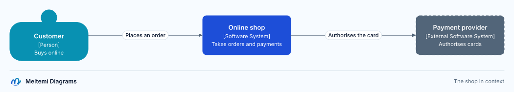
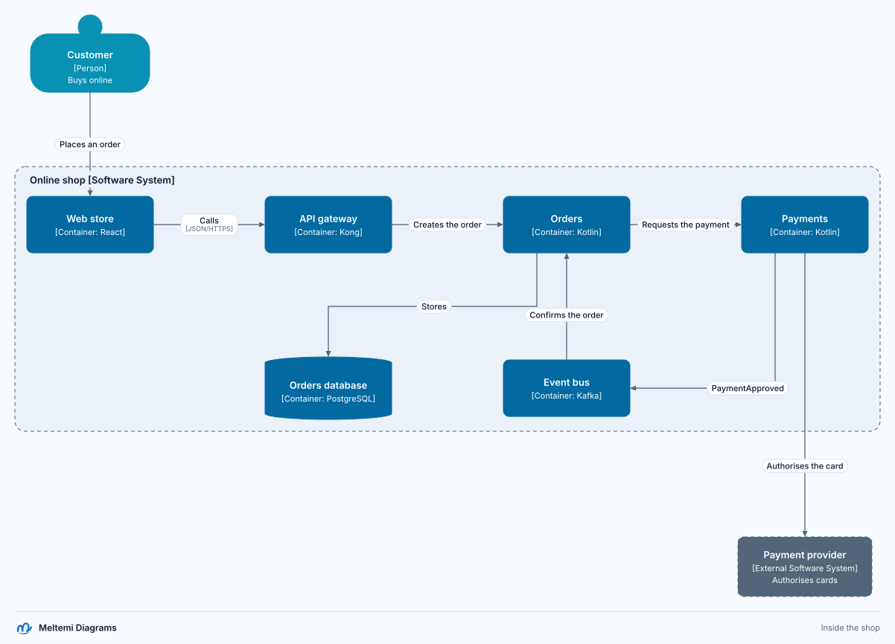
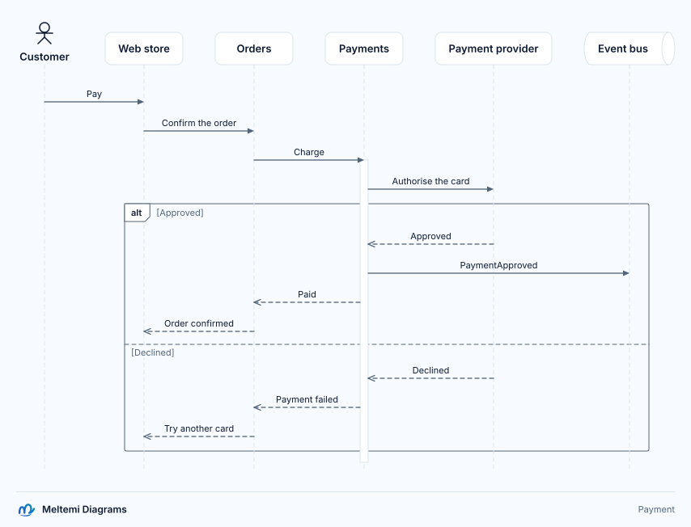
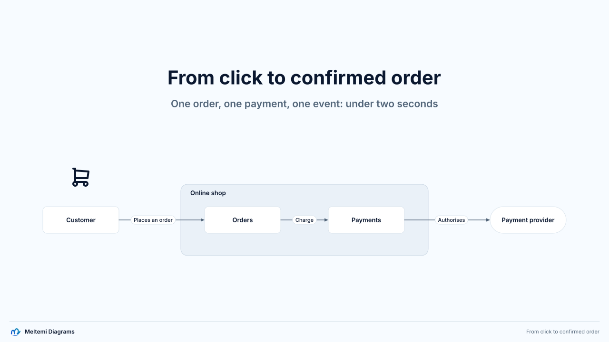
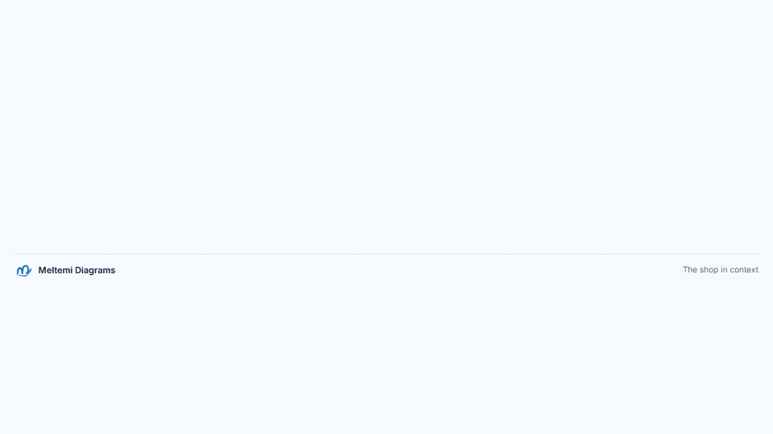

# The purchase example

The reference example of Meltemi Diagrams: one purchase, from the customer's click to the
confirmed order, drawn in every profile from one model. A customer, the web store, the API
gateway, orders, payments, an event bus, the orders database and an external payment provider
keep the same identity in every view, the sequence, the slide and the story.

It is the `purchase` template: `meltemi-diagrams init my-shop --template purchase` writes the
same project. The exports below are written by `pnpm gallery`.

## The model

[models/commerce.meltemi](models/commerce.meltemi) declares the people, systems, containers and
relations once. Views, the sequence and the slide refer to its entities, so a rename in the
model reaches all of them.

## Architecture

[diagrams/architecture.meltemi](diagrams/architecture.meltemi) holds two C4 views of the model:
the shop in its context, laid out automatically, and its containers, placed by hand.





## Payment sequence

[diagrams/payment.meltemi](diagrams/payment.meltemi) follows the payment between the
containers, with an approved and a declined scenario.



## Executive slide

[diagrams/executive.meltemi](diagrams/executive.meltemi) is a free 16:9 composition whose boxes
are entities of the model: [SVG](exports/executive.svg), [PNG](exports/executive.png) at twice
the pixels, [PDF](exports/executive.pdf) with selectable text.



## The story

[stories/purchase.meltemi](stories/purchase.meltemi) walks from the context to the containers:
it reveals the participants, morphs into the container view and traces the order and the
payment. It plays in the [HTML player](exports/purchase-story.html), and is exported as a 1080p
[MP4 video](exports/purchase-story.mp4) and a [GIF](exports/purchase-story.gif).



## The catalog

[exports/catalog/index.html](exports/catalog/index.html) is the project's browsable catalog in one offline
file: every diagram and the story, search, and links through the model's entities.

## Making it again

```bash
pnpm gallery
```
