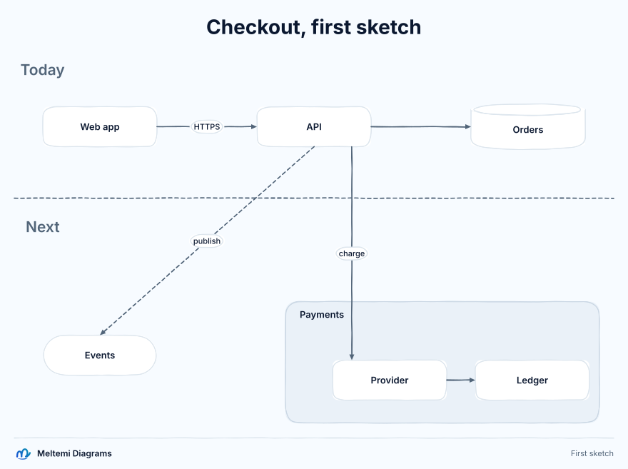

# Gallery

One sheet of each profile of Meltemi Diagrams, with its exports. Every picture is the
command line's export of the source beside it; `pnpm gallery` writes them again, and a test
checks that each SVG is what the source exports today.

The reference example, a purchase drawn in every profile with its story, video and
catalog, is in [examples/purchase](../examples/purchase/README.md).

## Flow: a delivery pipeline

Laid out automatically from the relations alone: groups, a decision, parallel branches, icons from the built-in Tabler pack and a flow effect on the release.

[Source](flow/delivery-pipeline.meltemi) · [SVG](flow/delivery-pipeline.svg) · [PNG](flow/delivery-pipeline.png) · [PDF](flow/delivery-pipeline.pdf)

## Sequence: sign-in with a passkey

Participants of three kinds, activations, replies and an `alt` fragment; each outcome is a scenario that exports on its own.

[Source](sequence/passkey-sign-in.meltemi) · [SVG](sequence/passkey-sign-in.svg) · [PNG](sequence/passkey-sign-in.png) · [PDF](sequence/passkey-sign-in.pdf)

## C4: the containers of a ride-sharing platform

One model of people, containers and external systems, and a container view placed by hand; other views of the model share every entity and relation.

[Source](c4/ride-sharing.meltemi) · [SVG](c4/ride-sharing.svg) · [PNG](c4/ride-sharing.png) · [PDF](c4/ride-sharing.pdf)

## Free: a roadmap slide

A 16:9 slide composed freely: measured text, groups placed by their interiors, icons and connectors between columns.

[Source](free/roadmap.meltemi) · [SVG](free/roadmap.svg) · [PNG](free/roadmap.png) · [PDF](free/roadmap.pdf)

## Free: a whiteboard sketch

The `sketch.light` theme paints every stroke by hand in two passes while the text stays crisp; a dashed free line divides what runs today from what comes next.

[Source](free/sketch.meltemi) · [SVG](free/sketch.svg) · [PNG](free/sketch.png) · [PDF](free/sketch.pdf)
