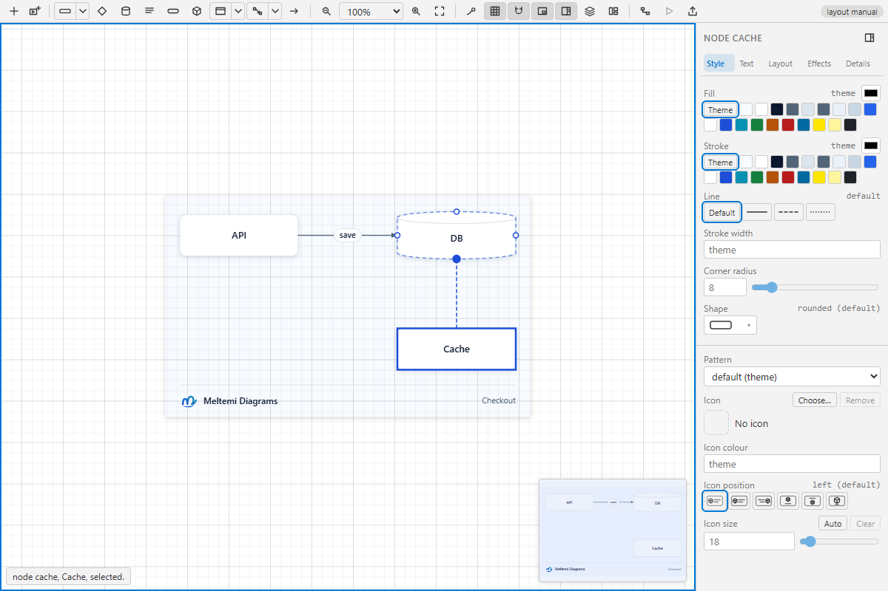

# Validation: Connection preview origin

Verified on Windows with installed Edge and the cached VS Code 1.141.0 against base `e99bf28`.
After rebasing onto `3cc55c0`, the five focused connection-preview scenarios passed again;
the intervening main changes do not modify the shared canvas, editor or VS Code host.

## Reproduction and visual check

The existing real-browser scenario that connects cache's north handle to db's south border was
extended to inspect the temporary wire before release. Against the original canvas it failed:
`preview starts at the north border`. The screenshot shows the line beginning inside Cache.
With the correction, the same assertion and the existing final-route checks passed.

The implementation uses the recorded source side and existing outline/rotation geometry. Exact
border points retain precedence. It does not populate the persistent start-attachment field,
so a drop onto an automatic target retains the existing routing behavior.

## Checks

- Focused connection/icon/Gantt browser checks: 45 passed.
- Additional Free-canvas scenarios: four passed, covering all four handles and cancellation,
  a rotated parallelogram with observed 200% zoom and pan, an arbitrary 37% border point, and
  an icon whose external label does not move its anchor or add a pinned automatic route.
- Full typecheck and lint passed. The final harness changes also passed its package typecheck,
  focused ESLint and formatting checks.
- Full unit suite: 11,291 passed, one skipped, with two workers on Windows.
- Full playground: 128 passed, zero failed.
- Native VS Code integration: 25 passed, zero failed, using the existing offline cache.
- Full shared webview suite: 310 passed, zero failed.
- VSIX packaging passed: 416 files, with the packaged webview hash matching the corrected build.
- Independent implementation review found no material defects.

The Free fixture initially exposed a test measurement of a transient, unrendered selection SVG.
The test now waits for a visible frame and reads connected geometry synchronously within the
page. No production delay, assertion tolerance or timeout was increased.

Full logs and additional captures are retained outside Git at
`C:/meltemi/artifacts/connection-preview-anchor/`. The before/after captures above use the same
flow scenario; the Free and transformed-shape checks exercise the shared implementation too.
